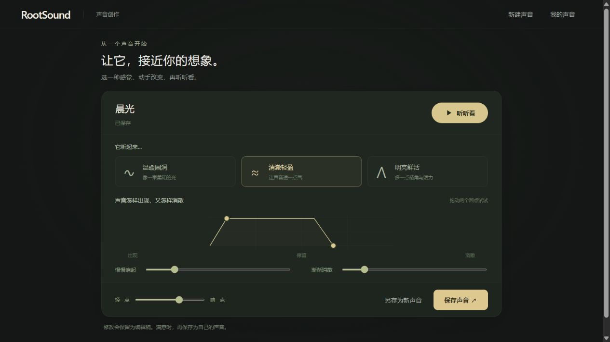

# RootSound 重建进展

更新：2026-10-23。范围：单音色基础验证，不代表完整工作站。

## 当前可以实际使用

欢迎进入 → 创建一个声音 → 选择声音感觉 → 直接拖动起落曲线或滑杆 → 试听/停止 → 改名、保存或另存 → 重开继续编辑。

“我的声音”同时提供已保存内容和未完成编辑稿的入口。试调只改变编辑稿；保存才更新共享内容。已有其他内容引用音色时，覆盖先列出直接及间接影响，并允许另存；该关系已通过集成测试验证，当前界面还没有乐句或歌曲编辑器用来创建这些引用。

## 新程序的组织

源码位于 `src/workstation/`；没有导入旧原型的业务或界面实现。

| 位置 | 职责 |
| --- | --- |
| `contracts/` | 同级共同遵守的内容、试听和音色编辑规范，不依赖具体模块 |
| `modules/materials/` | 保管已保存内容和独立编辑稿；身份、引用、修订、冲突、持久化失败处理 |
| `modules/timbre/` | 解释与编辑当前基础音色，产出试听安排 |
| `modules/sound-runtime/` | 实际发声、播放会话、停止、设备状态与资源释放 |
| `modules/ui-rendering/` | 欢迎、音色界面、图形操作和结果反馈；通过规范调用音乐能力 |
| `app/` | 装配共同规范下的具体实现；不计算音乐或转发每段音频 |

每个模块公开 `public.ts` 入口；对外只依赖共同规范和公开能力。没有为了组织图创建空部门，当前具体执行单位可以是无下级的模块。边界检查验证跨模块导入不会穿透内部实现。

## 已选择与试验选择

**用户已决定：Windows 桌面软件优先。** 没有安装桌面框架或宣称已经产出 Windows 可执行程序。当前已有浏览器环境用于先验证内容与协作；声音与存储接口可替换。最终桌面框架、文件保存和设备接口需后续实现。

以下均为首条流程的可调整实现选择：

- 试听输入使用明确频率（Hz）与时间（秒），不冻结乐句/歌曲的音高体系或音乐坐标。
- 基础音色支持三种波形组合感觉、起音/释放与音量。当前字段和数值范围不是未来合成、效果或声音创作的上限。
- 一个新试听替换旧试听。修改内容会停止旧试听，避免界面显示新值却继续播放旧设置；再次试听使用新设置。实时连续参数更新未实现。
- 保存数据有稳定身份与修订；保存时检查来源是否已变、依赖影响提示是否仍有效。当前只协调同一个库实例内的编辑稿，不承诺跨进程或多个浏览器页的写入协调。
- 临时持久化采用浏览器存储，由应用装配层注入；数据属于当前地址与端口，受浏览器数据生命周期影响。未选择最终工程格式，也没有把这个存储快照当成完整便携工程文件。
- 已保存数据损坏或无法读取时明确报错，保留原数据；写入失败时不提交内存状态，界面重读实际内容，不伪报保存成功。

## 旧原型与恢复

根目录仅启动、检查、测试和构建新项目。旧原型的源码、样式、模型测试、文档和原治理记录已移入 `legacy/prototype/`，拥有独立的 `index.html`、开发配置和启动器；新界面不再提供旧原型入口，生产构建也不发布旧页面。

需要运行旧原型时，双击 `legacy/prototype/RootSound.bat`，或运行 `npm --prefix legacy/prototype run dev`；默认地址为 `http://localhost:5174/`。新旧内容没有自动转换。浏览器按地址和端口隔离数据，旧地址中保存的内容仍需从该地址读取；移动代码文件不会迁移浏览器数据。

替换首页前已建立[旧工作文件快照](../legacy/prototype/docs/history/2026-10-22-prototype/SOURCE_SNAPSHOT.md)，逐文件核对内容。它包含未提交及新文件，不仅是 Git 旧提交；排除项和恢复方法均有记录。本次文件迁移前另存工作区与旧 Git 历史档案并核验，见[档案说明](../legacy/README.md)。活动 Git 已重新初始化，`legacy/` 仅作为本机恢复档案，不纳入新提交历史。

## 验证与仍未实现的范围

新项目验证命令：`npm run check`、`npm run test:workstation`、`npm run build`。旧原型独立使用 `npm --prefix legacy/prototype run check`、`npm --prefix legacy/prototype run test:model` 和 `npm --prefix legacy/prototype run build`，不属于新项目测试集合。新测试包含存储恢复与失败、编辑稿隔离、身份与引用、受影响保存、试听生命周期、设备失败、模块边界和跨模块真实流程。

界面验证包括开始创作、改名与声音选择、真实声音设备试听状态、直接曲线拖动、保存与刷新后的名称/参数恢复。试听状态通过实际浏览器音频接口验证；音质和延迟仍需用户实际聆听评价。

迁移后分别完成新工作站 25 项测试、旧原型模型 26 项测试，以及两个项目各自的类型检查和构建。根构建只生成新入口；独立开发服务也分别验证了入口、模块和旧样式能正确加载。已补充“旧未保存稿可找回”和“未知音色字段不被静默丢失”的回归验证。旧 Git 归档已解压并检查对象完整性及原提交，随后重新初始化了主目录仓库。

尚未实现新乐句/歌曲模块、共创/哼唱识别、采样获取、普通音频导出、离线渲染、完整工程打包和 Windows 桌面宿主。完整工作站的阶段验收仍按[重建计划](REBUILD_PLAN.md)执行。
