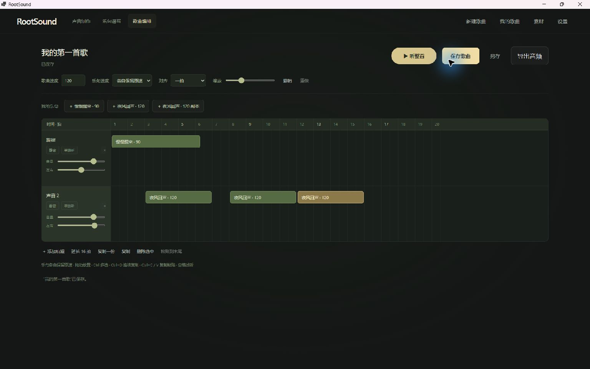
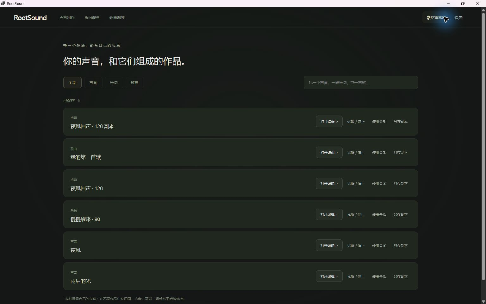
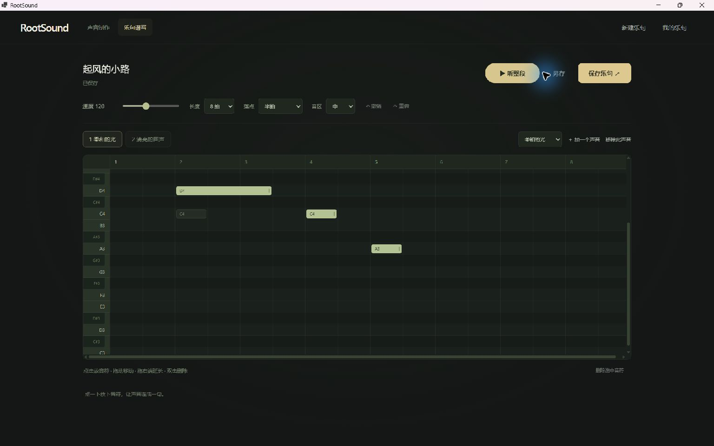

# RootSound 重建进展

2026-10-29（RB83）：修复约442MiB原生工程被旧128MiB上限拒绝，以及通过文件读取后
System.Text.Json对单个巨大字符串再次拒绝的问题。当前原生文件范围512MiB，标准JSON
大文本编码用于Read／Inspect／Create／Copy／Save／Rename，严格Unicode与控制字符
转义，原有UTF8字节范围继续检查。流式SHA256保持完整冲突保护，元信息逐字段脱离原始
大JSON文档，不重复缓存／克隆音频库；不改手动保存及失败保护规则。

发布`20261029-110855-201-33ecdb`：1109项全套、135项原生实际通过，含129MiB文件与桥接
读取、等长同mtime冲突、JSON语义／未知字段／无效Unicode。6份界面／根启动器／已测DLL
摘要相同，构建通过，.NET零警告零错误，Vite一条大小提示。
用户原件463,559,570字节SHA256`1471A294EF98B4750D4EDB36A86F518D1E4B4A34C861C56DD6CC1E1817E8847B`
和mtime／备份不变；原生Read返回JSON经生产TS平台、库及整曲试听计划检查，6轨42采样／
42触发、164.215714秒。完整副本验证草稿不写盘、手动保存、备份、冷重开和另存；原件不写。
证据`.test-output/rb83/`：最终构建／原生结果、真实工程`real/`报告及发布摘要。未测试
真实COM封送、可见GUI或实际声卡；大内嵌音频仍明显耗时、耗内存，不能推为交互／听感验收。

2026-10-29（音色结构：GPU与CPU默认）：项目内独立安装、校验官方2.7.1+xpu及Intel
依赖，本机Arc真实GPU多窗口模型运行、取消、GPU失败报告／自动CPU重试通过，显示
实际设备与部分算子的CPU协同。提供GPU／自动／CPU单选；用户测速后选择CPU，所有
入口及窗口默认CPU，默认打开窗口不初始化GPU，GPU仍可主动选择。原CPU组件、权重、
其他工具发布保持；float32推理，30秒合成混音CPU15.69秒/GPU21.51秒，声部最大RMS
差异2.04e-8，不能推为所有音乐的速度或听感验收。
发布 `20261029-095103-643-f6dd4e`：28项最终界面／CPU默认含真实推理检查；100项
后端及2471原生/21JS共享回归来自完整运行`20261029-094450-786-ec8ae7`，脚本／共享
DLL摘要相同。主／共享DLL、脚本、10份资源和入口校验通过；最终仅NU1900提示，未
显示用户桌面或使用真实声卡。证据在对应发布目录、完整后端目录及30秒测速目录。

2026-10-29（音色结构：五种可选原理）：新增小窗口，提供本地 Hybrid Demucs 乐器分轨、
中值 HPSS 持续／打击、非相邻近邻中值重复／变化、Mid/Side 中央／侧边、原 NMF 频谱
模板（2～8请求层数）。窗口显示适用条件与限制；不满足条件禁用，不暗中回退。
重新分解始终从原片段开始，替换当前结果，撤销恢复上一组声部／沉默状态；进一步分解
可另选方法且仅替换父层。模型利用已有本机组件／校验权重，脚本随发布打包，分窗处理、
禁用网络、不自动安装下载；保持采样率／声道／完整帧数，其他层保留互补重建残余。

发布 `20261029-090259-774-aa8f82`：80项结构、2471条共享原生和21项 JS 检查通过，
含三种新传统方法的实际受控分配、721秒有界参考／尾端分析、真实模型单声道及多窗口
双声道推理、互补重建（最大2.98e-8）、换方法／细分／撤销／取消、离屏选择窗口。
实际启动器目录的模型定位也已检查。主／共享 DLL、模型脚本、10份资源、入口与测试
匹配，原音色器发布不变；证据在 `.test-output/tone-structure/20261029-090259-774-aa8f82/`。
仅 NU1900 审计源提示；未显示用户桌面窗口或使用真实声卡。仍可能串音／误分类，真实
音乐的听感、实用性与偏好选择待用户试听；模型运行和受控指标不代表听感验收。

2026-10-29（独立实验：音色结构）：新增 `experiments/music-workflow/音色结构.exe`。
共享歌曲截取／EQ 传入长片段，在新结构页学习相似／重复频谱模板，互补分配成同时发生的
声音层；全部激活重建输入，不把完整原声重复混入各层。进一步分解只替换选中父层，独立
激活／沉默、同步播放和共享定位、8步撤销、最多16当前层、声部／激活混合 WAV 导出。
按用户澄清，各图横轴频率、纵轴音量，曲线随时间变化；单独的时间条拖动播放头。
跨页保留歌曲状态，源数据与声部使用磁盘缓存、有界缓冲和取消；新输入替换分析前提示。

发布 `20261029-082851-912-0a8d89`：41项结构检查通过，合成混音4层总和误差2.98e-8，
含真实传递40秒、721秒磁盘输入、分解／细分／撤销、独立激活、共同播放时钟、取消清理、
原件保护、隐藏 WebView2 与离屏对齐／定位图像。共享2471条原生和21项 JS 结果复用
`20261029-082453-646-85f042`完整运行，DLL相同。已测两份 DLL、10份资源与入口摘要
匹配，原音色器发布未改；构建仅 NU1900 审计源提示。证据在
`.test-output/tone-structure/20261029-082851-912-0a8d89/`。没有显示用户桌面或使用真实声卡。
这是频谱结构估计，不承诺精确乐器分轨；真实音乐的串音、听感和实用性待验收。

2026-10-29（音色器蓝线）：两页蓝线可自由交叉，拖动身份不交换，按夹住的时间处理／保存。
歌曲页改为沿当前设备时钟更新循环边界，蓝线拖动不暂停、不反复定位，红线继续移动；
只有触到新边界才改变循环位置。用户明确否定了拖动期间暂停的方案。起止数值保持时间顺序，
空选区不能播放，其他独立旧工具保留原默认边界规则。
发布 `20261029-072844-107-70b070`：21项 JS、2471条原生断言（含102条蓝线专项）、
打磨79组和采样编辑60组通过。真实播放引擎配模拟设备验证时钟前进且拖动不触发定位／暂停／重启；
10份资源／已测 DLL／唯一入口摘要一致，已删除的旧入口仍不存在。仅 NU1900 审计源访问提示。
证据在 `.test-output/tone-processor/20261029-072844-107-70b070/` 及
`blue-sample-editor-regression/`，未显示用户窗口或使用真实声卡；实际听感待验收。

2026-10-29（独立实验：音色器合并）：音色打磨与歌曲截取／EQ 合为同一工具，入口
`experiments/music-workflow/音色器.exe`，旧“音色打磨.exe”也指向它。初始打磨界面，
左侧采样栏下方＋进入截取；导出蓝线内经过 EQ 的独立音频快照到采样栏，自动返回，后续
追加参考。歌曲、标记、缩放／平移、EQ、剪切撤销记录保留，可多次截取；直接返回不添加。
切换停止当前试听；每段30秒／8段范围及原文件保护沿用。用户确认仅本次会话保留，不要求
关闭重开恢复；主工作站范围未变。

发布 `20261029-070259-090-f46dbd`，21项 JS、2369条原生断言（新增27项合并流程）
与原打磨79组通过。实际隐藏 WebView2 EQ 传递／−12dB结果、连续截取、状态保留、满栏、
取消、独立快照和关闭清理覆盖；10份资源／已测 DLL／两个入口摘要一致，构建脚本语法与
编码通过。仅 NU1900 依赖审计源访问提示。证据在
`.test-output/tone-processor/20261029-070259-090-f46dbd/`，未显示用户窗口或使用真实声卡。
实际试听和操作体验待用户验收。

2026-10-29（独立实验：音色器）：新增 `experiments/music-workflow/tone-processor/` 和
`experiments/music-workflow/音色器.exe`。支持多格式、超过10分钟音频，频谱三线与横向缩放、
蓝线范围循环、播放／暂停与回到左蓝线、剪切与撤销；原样共享精细音色生成器的 EQ 图、样式
和滤波器生成算法，试听显示加工后频谱。根据用户补充，只导出蓝线范围及 EQ 结果为 WAV。
原始文件只读，磁盘缓存与固定缓冲区处理长音频，后续加工可继续接入音频处理链；本轮不做音色类型。

发布 `20261029-003347-724-8db1f6`：21项 JS 检查、2342条原生断言通过，含721秒音频
导入／完整导出、实际 WAV／MP3／FLAC／M4A 解码、原 JS EQ 与原生卷积采样值比对、选区
导出／循环／回到开始／取消保护，以及隐藏 WebView2 实际模块、worker 与桥接更新。
10份界面及共享资源、已测 DLL、入口摘要匹配。构建有 NU1900 审计数据源访问提示，无代码错误。
证据见 `.test-output/tone-processor/20261029-003347-724-8db1f6/`；未显示用户窗口、未用实际声卡。
实际听感与操作体验待用户验收，不改变主工作站范围。

2026-10-29（RB82）：选中单个音符后，在卷帘普通纵向滚轮向上延长、向下缩短真实持续秒数。
按设备单位归一，普通一格约10ms、小量输入更细，大量输入限幅。同步更新拍长表示、宽度、
时长控制台与实时播放回调，不改起点／音高／音色／混音／选择／视图／播放头；可撤销。
音名区、标尺、修饰键、纯横向输入及只选总音符时保留导航。先整理待提交参数再读取新值，
保护极短音符、自然尾音、旧rhythm族、超过96秒旧拍长音符（逐步缩短而非骤截）；弹窗、
无效输入与失败不改变原稿。仅修改工作草稿，不绕过手动保存。

新增5项，71项编辑器目标及1109项全套通过。发布`20261029-000655-082-02a1de`，6份界面及
根启动器摘要匹配；类型／桌面构建成功，.NET零警告零错误、Vite一条包大小提示。DLL同RB81，
复用已有134项原生结果，本轮未重跑。证据`.test-output/rb82/`内`targeted-tests.log`、
`full-tests.log`、`desktop-build.log`和`release-verification.json`。未操作真实桌面／声卡或
修改用户工程，实际滚轮手感待验收。

2026-10-29（RB81）：用户明确不要自动保存，并确认乐句保存加入当前工程、乐曲保存统一
写文件。修正NativeStorage每笔编辑直写正式库的旧行为：普通Write/Checkpoint只改工作内存，
Read不再用磁盘覆盖工作态；Save才写，Discard/Dispose不写，正式字节、mtime、备份和音色
镜像保持。dirty Open/Create拒绝切换，明确CreateCopy可另存，legacy双文件保存失败保护保留。

新乐句用通用Draft.projectRootId归属歌曲、可访问音色和保留命名隔离，保存前无phrase Content
及member／库卡片；显式保存才发布。库不再用草稿名覆盖正式名。乐句退出提供保存／放弃／
继续，放弃真实恢复已有稿或删除新稿／子稿、清理历史，不依赖仅脱离上下文的cancel。
另存成功后清理旧稿，失败保留原稿；副本已建但清理失败时回到可操作原稿，不隐藏挂起。
歌曲保存、另存及宿主关闭的保存均检查未提交乐句。关闭窗口的请求ID异步准备握手只整理
输入，不隐式保存；保存受阻仍允许明确放弃，取消留窗。删除乐句不再顺带保存整个工程。

1104项全套通过，最后两处测试类型解析收尾后43项集成复测通过；相关目标156/64/37项通过。
最终发布`20261028-232852-347-cd9d33`实际重跑134项原生检查：61目录、21音色（含真实TS夹具）、
14MIDI及38存储／音频／工程／采样；无旧证据复用。6份界面及根启动器摘要匹配，类型／桌面
构建成功，.NET零警告零错误，Vite一条包大小提示。证据`.test-output/rb81/`内
`full-tests-final.log`、`final-integration-tests.log`、`phrase-product-tests.log`、`root-final-targets.log`、
`native-final/`报告、`desktop-build.log`、`release-verification.json`，归属日志另在
`.test-output/draft-project-ownership-final-tests.log`。没有GUI／声卡操作或用户工程写入，程序化
关闭准备检查不代表真实窗口交互验收。

2026-10-29（RB80）：用户明确保留总览，从左侧“创作”进入编辑；上方原旋律区改称创作，
右侧入口删除，下方原节奏区改成乐句控制台。显示名称、BPM、时长、小节、音符／音色数量
和总音量；分界可拖动并保留原对称上下限、取消、键盘与挂载记忆，默认上方75%。播放头
止于上方，控制台操作不平移或定位预览，两个音量滑钮共享实时预览及单次提交／取消。

旧节奏族不删、不强制改写：原ID、section、音高、时间均保留，统一按音高预览／编辑，
所有声部共同试听；旧rhythm细调路由映到创作。旧族可换音色，统一移除本乐句用途采用all
原子事务，其他歌曲／乐句及共享素材仍保护；保存、撤销、重启撤销和便携工程保持。

1082项全套通过，另有90项统一编辑／helper、87项外壳／生产、13项预览／分界目标结果。
发布`20261028-225000-650-e494a9`，6份界面及根启动器摘要一致，类型／桌面构建成功；.NET
零警告零错误，Vite一条包大小提示。DLL同RB79，复用已有130项原生证据、本轮未重跑。
证据`.test-output/rb80/`的`unified-creation-tests.log`、`preview-split-tests.log`、`full-tests.log`、
`desktop-build.log`、`release-verification.json`及`.test-output/rb80-ui-final.log`。
未操作真实桌面／声卡、未改用户工程；程序结果不等于真实布局、手势或听感验收。

2026-10-29：精细音色生成器按用户确认的三图方案加入只读实测叠层：频谱显示实际输出电平，
音量显示峰值历程，音高显示相对最近琴键的主音高估计。粉紫色分析位于设置曲线后方，随
缩放/平移与持续/释放坐标同步；停止保留最近记录，换音/改参重新采集。分析不占用控制点、
不改撤销/保存。合并声道的8192点FFT、可信周期检测、已知多音留空、静音/噪声/快速变化
不可靠时留空，分析刷新限20次/秒并限制历史大小；音高估计和窗口延迟有说明。

84项界面/合成/分析/通信检查通过，发布 `20261028-224430-525-f64420`（UTC标识），13份
界面与源码、入口与启动器摘要分别一致。原生DLL与目录记忆版本逐字节相同，复用44项
原生结果未重跑，发声DSP未改。构建0错误、保留NU1900审计源不可达警告。证据在
`.test-output/spectral-forge/analysis-overlays-*`，另有真实控制器产生的SVG坐标离屏图。
无头浏览器未能运行，故不是浏览器或真实应用截图；未操作桌面/声卡，实际窗口及听感待体验。

2026-10-29（RB79）：行控制块横向速度暂定为鼠标的0.75倍，纵向不变，继续限制左右范围，
按实际显示位移渐隐列线／渐显垃圾桶，到右界实际松手才删除。乐句库双击现在打开原乐句
谱写，包括未显示在编排左栏的乐句；取消所有待执行的单击切换，不复制或改变显隐。
单击显隐及拖删确认保留；打开失败留库内重试，关闭时不抢新页面焦点，旧定时回调和已关闭
卡片不再误改内容。原库内双击改名被替代，名称仍可在乐句顶栏修改。

1070项全套通过，含128项库／工作站目标检查、11项行拖目标检查，生产流程验证隐藏乐句
打开、顶栏与旋律编辑可用、歌曲与源身份保留。发布`20261028-223403-850-2f282b`，6份界面
及根启动器摘要一致，类型／桌面构建成功；.NET零警告零错误，Vite一条包大小提示。DLL同
RB78，复用已有130项原生证据、本轮未重跑。证据`.test-output/rb79/`内`row-targeted-tests.log`、
`library-and-studio-tests.log`、`full-tests.log`、`desktop-build.log`及`release-verification.json`。
未操作真实桌面／声卡、未改用户工程；自动检查不等于实际手势或听感验收。

2026-10-29（RB78）：行控制块可以同时横纵拖动，取消方向锁；左移不能越过控制列左缘，
右移上限暂取实际控制列宽（普通144px、窄屏116px），相邻行继续纵向让位，松手以两轴动画
落位。垃圾桶以平方进度更慢渐显，列线共享层只对当前拖动行的显示区段随右移渐隐，拖回
恢复；其他行网格保持。实际松手抵达右界才删除，非空行仍需确认，否则按纵向目标重排。
取消、失去捕获、Escape、滚轮、保存、刷新、卸载均清理临时遮罩／位移，不提交拖动中的
移动，不重启播放；右界和曲线是实现选择，并非永久产品限制。

1065项全套通过（包含93项编排／性能目标检查），类型及桌面构建成功。发布
`20261028-222504-709-90af35`，6份界面及根启动器摘要一致，.NET零警告零错误，Vite一条
包大小提示。DLL同RB77，复用同DLL已有130项原生证据、本轮未重跑。证据`.test-output/rb78/`
中的`targeted-tests.log`、`full-tests.log`、`desktop-build.log`和`release-verification.json`。
未操作真实桌面／声卡、未改用户工程；自动检查不等同于实际手势、FPS或听感验收。

2026-10-28（RB77）：用户澄清“选中音符”是选中左侧总音符。空白处左拖现在绘制音符，
连续显示宽度、锚定起点／音高／音色，松手才一次保存、选中和试听；未选中、Alt或中键拖动
仍平移，已有音符移动和边缘改长保留。取消不写资料，临时绘制不加入音频计划。

乐句顶栏新增“每拍格数”，2～9整数、旧省略值为4，旋律／节奏共用并可保存、撤销和移植；
改变细分不挪已有音符、不改变持续秒数。格线、录入／休止、快捷移动、鼠标落点及数字框
跟随n；分数乐句末尾仅接受完整小格，不足一格时明确拒绝新增而保留旧音符。
自建、导入、改过及存在未保存参数变化的音色移除前确认；未动过的自带音色保留快捷移除。
乐句与乐曲库已有确认保留。行右拖显示逐渐加深的红色垃圾桶，当前阈值140px，只有实际
松手才可能删除；空行直接删，含片段先确认并核验整行未变，取消恢复选择且不重启播放。

1062项全套通过，发布`20261028-113909-491-547a50`，类型／桌面构建成功，.NET零警告零错误，
Vite一条包大小提示。全部6份界面与根启动器摘要匹配，DLL与RB76相同，复用同DLL已有130项
原生结果（本轮未重跑）。证据`.test-output/rb77/`的`full-tests.log`、`desktop-build.log`、
`release-verification.json`，另有顶栏／来源分类与生产流程目标日志。未操作桌面、声卡，
未修改用户工程，程序检查不等于实际手势、FPS或听感验收。

2026-10-28（RB76）：新乐句继承创建时播放头位置对应的编排网格BPM，复制保留原速度。
未使用的默认音色可通过库内垃圾桶删除，种子准备只执行一次，跨部、重开及便携转移不复活。
保护已有引用、未保存改动及独立撤销历史；已使用音色保留原来的“移除当前分部用途”行为。
音色库可二维拖动让位排序，顺序按歌曲保存，完整工程导入重映射顺序标识。
纯音色库元信息修改同时校准引用工作稿的对应元信息快照，音乐冲突保护保留。

设置只显示键盘演奏；旧入口设置保留作兼容资料，不再隐式跳过欢迎页。
SPN音名及行控制块默认竖滚、Ctrl竖缩、Shift横滚、Ctrl+Shift横缩，右侧网格规则保持；
长控制台局部横滚，实际滑钮目标仍用滚轮调参数。1025项全套通过，发布
`20261028-105314-011-85d7f3`，类型及桌面构建成功，.NET零警告零错误，Vite一条包大小提示。
6份界面及根启动器摘要匹配；DLL与RB75相同，21项音色原生检查以新删除／排序工程重跑，
其余109项旧原生证据复用，未宣称重跑。证据`.test-output/rb76/`内`full-tests.log`、
`desktop-build.log`、`release-verification.json`及`native/checks/timbre-files-report.json`。
没有真实桌面、声卡、FPS或听感验收，没有修改用户工程。

2026-10-28（RB75）：音色库新增“＋”文件导入并记住上次目录，接收`.rssynth`／`.rssound`完整
参数或封闭采样图，原子建立本曲独立身份，同曲乐句共享、跨曲隔离，不自动创建音符；旧
`.rstimbre`实验采样归档仍明确拒绝，不近似转换。精细曲线保留，按逐音音高／力度／gate后台
准备；跨音符单音滑音和全局非线性效果不同于实验多音引擎，尚无听感等同验收。
`D:/RootSound/timbres/<manifestGUID>/`是可恢复镜像，自包含`.rootsound`仍为权威；投影只取
当前根的成员与有效工作稿，排除他歌、历史及陈旧修订。外部修改及额外文件保留并提示，
项目删除只清理摘要未变的受管理副本。源文件与已有工程不自动重写。

乐句当前额度1024拍／256小节、50000音符；MIDI取消固定16拍／512音符切割，仅因真实速度
或资源边界分段。实际Vulcanus为17行／17片段（原225），5267音符／164.0213秒全部起止、
前后空拍、便携重开、编辑保存及撤销核验通过；旧项目需重新导入才采用新分段。最长乐句
579.5417拍／917音符。仍保留600秒、256个同时波形声源及128MiB精细渲染工作集等限制。

1001项全套通过，随后保存字段收尾通过27项受影响UI复核和类型检查；11项精细合成检查含
真实后台Worker取证。发布`20261028-101232-024-28ef6a`，.NET构建0警告0错误，TypeScript/Vite
成功，保留一条JS包超过500KB的非阻断提示。最终宿主重新通过130项原生检查（21音色+57目录
+14MIDI+38文件音频工程），未复用旧二进制证据；6份界面与根启动器摘要一致，两个实际源摘要
未变。证据：`.test-output/timbre-import/`的`final-full-tests.log`、`final-editor-tests.log`、
`desktop-build.log`、`release-verification.json`、`spectral-actual.json`及`native/`报告；另有
`.test-output/midi-phrase-length/actual-conversion.json`。没有桌面、真实声卡、FPS或听感验收。

2026-10-28（RB74）：乐句总览的旋律部与节奏部可拖分界调整高度，左右控制栏同步。
只有一部没有预览音符时，初次打开默认把空部缩至最小；双方都有或都没有音符时均分，
未定义音色的音符仍算内容。当前15%～85%对称范围、尽量每部64px、极小窗口均分、
键盘上下及Home/End调节均为实现选择，不是新增永久产品约束。

布局只在当前挂载界面内存中保留：同稿刷新、原位保存续稿及详细编辑往返保留，真正打开
新稿重新选择默认。窗口缩小时只夹住显示比例，恢复大小后保留理想比例；零高度不覆盖偏好。
Escape或指针取消恢复手势前比例与两部纵向位置，失去指针捕获结束调整。分界拖动合并到动画帧，
不修改资料、重新准备音频或打断当前播放，横向共用与纵向独立的导航规则保持。

最终970项全套检查通过，发布 `20261028-092408-127-7b6e7e`，构建0警告0错误；全部5份界面
文件及根启动器摘要一致。DLL与RB73逐字节相同，复用同DLL的14+57+38项原生结果，本轮未重跑。
9项新增目标已纳入全套，覆盖四种音符分布默认值（含未定义音符）、对称边界、左右同步、
取消恢复、保存续稿／新稿、详细页往返、小窗及零高度、纯视图无数据或音频副作用。
证据在 `.test-output/phrase-divider/` 的 `final-full-tests.log`、`targeted-tests.log`、
`cancel-targeted-tests.log` 与 `release-verification.json`；没有操作真实桌面、声卡或测量FPS。

2026-10-28（RB73）：歌曲编排、旋律卷帘和节奏序列的空白拖动支持横纵同时平移。乐句总览
显示两部各自的真实音符预览：旋律按全音高行、节奏按本部音色行，未定义音符保留暗色。
横向位置与缩放共用秒坐标，纵向位置及行高分部独立；进出详细编辑与原位保存保留当前导航。
导航只属于本次挂载的内存，不写工程格式、不承诺软件重启恢复。总览仍只读，无行列网格，
通过右侧“创作”进入编辑；此范围更新了RB58/59所述空白总览。

实现选择：4px区分点击与空白拖动，视口更新按动画帧合并；预览裁剪视口并复用音符节点。
全乐句音色标识排序后按hash与八色避碰，两部及详细编辑使用同一映射；初始旋律聚焦可见
音符较集中的音区，不裁减全音域。BPM改变起音位置，固定持续秒数保持，增小节、换音色、
删音符与保存后的快照同步到预览。视图操作不修改资料稿、不切换播放session或增加播放头。

961项全套检查通过，发布 `20261028-085938-686-f0e69d`，构建0警告0错误；全部5份界面文件
及根启动器摘要匹配。DLL与RB72逐字节相同，复用同DLL的14+57+38项原生证据，本轮未重跑。
覆盖7项独立预览、真实mountStudio集成、歌曲斜向拖动及子编辑器点击/拖动与视图交接；
检查中资料token和整稿不变、播放保持同一playing会话与唯一可见头、固定秒时长音符的
显示宽度不随BPM改变，预览新增/删除/换色保留正确身份。证据在
`.test-output/two-axis-navigation/` 的 `full-tests.log`、`desktop-build.log` 与
`release-verification.json`。没有操作真实桌面或声卡，也未测量实际FPS或完成听感验收。

2026-10-28：精细音色生成器的“打开”记住上次选中文件的目录，退出重开仍保留；首次使用或
目录不可用时才回退到 `output/`。记录与恢复稿分开，清除恢复不丢目录；记录损坏或写入失败
不会阻止打开音色。本次44项原生检查通过；发布 `20261028-085914-279-8eb9f2`，12份界面文件
与此前69项程序检查版本逐字节一致，未重复其检查。构建0错误、保留NU1900审计源不可达警告。
入口/启动器摘要一致；证据 `.test-output/spectral-forge/open-directory-*`。未操作实际桌面或声卡。

2026-10-28：按用户指定 Vulcanus 前20秒及“3～10秒密集、10秒后稀疏清晰”的线索，使用已发布
精细音色生成器引擎制作两份 Kick 合成近似，交付到 `D:/Sound/temp/tone/`：A“密集短击”、
B“下潜重击”的 `.rssynth`、对应单击WAV、先A后B对比试听和说明。三条曲线各10点，未使用
原曲采样或工具外效果，没有修改工具。环境不支持直接音频输入，只按瞬态/下滑/尾音分析制作；
尚未确认原曲独立kick数量、A/B对应或相似度，用户听感验收待进行。

音色冷读重渲染与单击WAV逐字节一致，48kHz/24位立体声、峰值约−3.1dBFS、无削波或尾音截断；
A/B的99%输出能量分别集中在约145/220ms。原曲和目标目录原有6个文件摘要保持不变。
证据：`experiments/music-workflow/spectral-forge/cases/vulcanus-kicks/` 的 `delivery-final/`
三份核验报告及 `delivery-copy-verification.json`。信号正确不等于音色已匹配或听感通过。

2026-10-28（RB72）：修复歌曲编排滚动卡顿。视口平移和缩放使用当前歌曲与乐句目录快照，
连续滚轮通过动画帧合并绘制，复用可见乐句、网格和行节点；行控制块、左栏与控制台不随视口
重绘重新构建。离屏节点回到视口时同步名称、颜色、独奏、静音与选中状态，避免旧选择残留。
可见的改名输入保持原节点，真正离屏前先失焦保存，避免滚动丢失输入。

乐句目录改为一次读取当前工程范围，再批量读取已授权乐句，按资料库对象、歌曲标识与版本
保留一份元信息缓存；编辑、撤销、重做或切换歌曲后刷新，返回独立副本。当前歌曲、公共来源
与历史保管内容的隔离没有放宽，单项查询仍独立验证归属。实际225乐句库的离线目录调用中位
耗时约250→7.23毫秒（冷读），相同版本暖读约0.0063毫秒；暖读数值不含额外的歌曲读取。

943项全套检查通过，发布 `20261028-082554-119-721963`，构建0警告0错误；5份界面与根启动器
摘要匹配。宿主DLL与RB71逐字节相同，复用该DLL的14+57+38项原生结果，本轮未重复运行。
实际17行／225片段／5267音符工程的独立无界面测量：同一帧前连续30次滚轮，乐句列表调用
150→0、新建DOM节点3649→0、行控制块重建30→0，合并为一次动画帧；方向键平移与缩放没有
读取歌曲或素材。源工程摘要保持不变。这些是离线调用、模拟DOM和调度证据，不是真实FPS、
桌面操作、声卡或听感验收。证据在 `.test-output/playlist-performance/` 的 `final-full-tests.log`、
`before-domain.json`、`after-domain.json`、`before-ui.json`、`after-ui.json` 与
`release-verification.json`。

2026-10-28（RB71）：修复5267音符MIDI被旧2048全曲上限挡住的问题。转换、歌曲计划与声音
执行共用50000个发声音符总量上限；长序列按设备时钟提前准备短窗，及时释放结束节点。暂停、
续播和热更新沿原时钟重新准备，离线导出在同一时钟分批准备，保留跨窗长音。仍保留10分钟、
256个同时波形声源、任意0.35秒内4096个提前准备波形声源等防护，以及128行、512片段、
单乐句512音符／64拍等范围；超限明确拒绝，50000并非无限容量。

935项程序检查通过，发布 `20261028-075611-023-8c2aa1`，构建0警告0错误；全部5份界面文件
与根启动器摘要一致。宿主DLL与RB70逐字节相同（`nativeMatchesPriorRelease=true`），复用
该DLL的原生MIDI14、项目目录57、文件／音频／工程／采样38项检查，本轮未重复原生测试。
实际 `D:/Sound/temp/midi/Vulcanus.mid` 的5267音符、164.02秒转换为17行／225片段；逐音
核对源起点和持续秒数、便携重开、编排移动撤销重做、乐句修改保存后冷开全部通过，源摘要不变。
48kHz计划验证最多同时152个波形声源；假设备全程模拟调度21068个声源，全部起点一致，最多
保留264个源（含提前准备），最终全部节点释放。证据在 `.test-output/midi-capacity/` 的
`full-tests.log`、`actual-conversion.json`、`actual-runtime-validation.json`、
`actual-windowed-verification.json` 和 `release-verification.json`。没有真实GUI、声卡或听感验收。

2026-10-28（RB70）：主工作站新增乐曲库文件夹框的 `.mid` / `.midi` 导入。标准 MIDI 格式0/1、
PPQ文件转换为默认目录的新 `.rootsound`，重名时按实际项目文件名和显示名避让，随后进入歌曲
编排；源文件只读。轨道、通道及乐器分声部，打击音进入节奏部；音符的实际起止、力度、起音时
的音量／表情及声像保留，速度变化与踏板延音按源时间转换。零长度鼓触发采用有说明的0.12秒
击发时长。音色为本地合成器近似，可继续更换，不声称恢复原采样、插件或完整混音。

进入后显示可展开的导入说明；弯音、触后、连续控制等未还原内容有提示。格式2、SMPTE、损坏
及超限文件明确拒绝，创建前完整校验而不截断。读取上限10 MiB；转换受当前整曲2048个发声
音符／10分钟、128行、512片段和单乐句64拍等限制（2048为本批历史上限，现已由RB71替换为50000）。非拍边界变速可能重启视觉网格相位，
不改变源音符的实际开始时间和持续秒数。本轮不含真实桌面操作、声卡试听或用户听感验收。

RB70验证完成：全套923项检查通过，发布 `20261028-073219-333-6af978`，构建0警告0错误。
最终宿主重新通过原生MIDI14项、项目目录57项、文件／音频／工程／采样38项检查；全部5份
界面文件与根启动器摘要匹配。证据为 `.test-output/midi-import-all-tests.log`、
`.test-output/midi-import-final-native/{midi,projects,files}/` 中的报告，以及汇总
`.test-output/midi-import-release-verification.json`。真实文件框人工操作尚未进行。

2026-10-28 使用已发布精细合成工具，为 Vulcanus 0～20秒人声下方的持续铺底制作首版合成
近似，交付 `D:/Sound/temp/tone/Vulcanus-铺底音色.rssynth`、C4持音WAV、和弦试听与说明。
静态频谱10点、音量8点、音高3点，8振荡单元／音，支持6复音；未加入原曲采样或工具外效果。
参数冷读重渲染与交付C4 WAV逐字节一致，48kHz PCM24立体声、数值／输出余量／完整尾音已
校验；原曲及目标目录原有文件摘要保持不变。分析仍含混合声部，本次不声称已分离原始pad或
通过音色相似度听感验收。证据在 `experiments/music-workflow/spectral-forge/cases/vulcanus-pad/`
的 `delivery/delivery-verification.json` 与 `delivery-copy-verification.json`；主程序和生成器未改。

2026-10-28 按用户最新反馈将实验包络限制为每条最多10点，新建与预设默认各6点，以“点数”
滑钮替代“加密”。频谱2～10点；有独立持续点的时间包络最低3点。一次滑动一次撤销，往返使用
手势初始曲线重算；首尾与持续位置保留，减少点时拟合重要峰谷。旧512点文件完整校验后可简化
打开，原文件在明确保存前保留。发布 `20261028-055644-757-e7928b`，69项Node与35项原生
检查通过，12份界面与启动器摘要匹配，0错误、保留NU1900联网审计元数据警告。证据为
`.test-output/spectral-forge/{count-slider-build.log,count-slider-release-verification.json}`。
未操作桌面或启用真实声卡；以下较多控制点的版本由此条更新，作为历史保留。

2026-10-28 精细合成实验控制点补充：新建与全部预设现在默认为频谱64点、音量32点、音高32点；
每张图新增“加密”，可逐次增至512点，保留原锚点和持续位置、以低误差拟合弯曲段，并支持一步
撤销。旧文件不会自动改写，可主动使用该按钮。频谱归零也保留64点。发布已更新为
`20261028-054610-772-b94b49`，60项Node与35项原生检查通过，12份界面文件和启动器摘要一致。
证据：`.test-output/spectral-forge/{density-build.log,density-release-verification.json}`。
未操作桌面或启用真实声音设备；下方首版记录保留为历史。

2026-10-28 独立精细合成实验已构建，入口：`experiments/music-workflow/精细音色生成器.exe`。
四振荡器与静态频谱、动态音高、音量三条多点曲线，每条最多512点，支持精确输入、曲率、
缩放、持续/释放、撤销及实时试听；另有齐奏、相位调制、双LFO、饱和、合唱和回声。
原生 `.rssynth` 保存、恢复稿、44.1/48/96kHz PCM24 WAV导出已接通。独立结果默认留在
`experiments/music-workflow/spectral-forge/output/`，其中 `examples-2026-10-28T05-19-15-000Z/`
提供9份参数和4段离线示例；没有从歌曲提取采样。

发布 `20261028-051926-028-54cc00`，51项Node与35项原生文件检查通过，11份界面文件和
启动器摘要匹配，构建0错误，仅保留NU1900网络审计元数据查询警告。证据在
`.test-output/spectral-forge/{final-build.log,release-verification.json,engine-performance.json}`。
48振荡单元预算限制高负载时的复音并明示实际数量；8192点最小相位FIR、128帧分块，
48kHz时频率分析间距约5.86Hz，总算法延迟约2.99ms。极端快速换音、系统抢占仍可能
超过实时期限；2倍过采样不保证极端调制完全无混叠。本轮仅做程序和离线音频检查，
没有桌面操作、真实声卡试听或用户听感验收；主程序仍为下述RB69，已有工程未改。

2026-10-27 产品目的变更（用户已确认）：**让音游曲爱好者快速上手做出满意的音乐。**
项目受众：音游曲及周边曲风爱好者。
下一阶段的已确认里程碑是先把一段原创片段做到满意，再沿同一流程扩展成整曲。
用户已选定首个听感参考：`D:\Sound\temp\music\vulcanus.mp3` 的 0–20 秒，服务于原创、可编辑片段的制作。
20 秒是参考窗口，不自动限定原创片段长度；本次选择不新增提取、转售参考音频或主张其版权的授权。
此文件不等同于此前 `Vulcanus.wav` 25–35 秒的失败实验，旧实验的质量结论不变；本次选择也不是听感验收。
此前面向所有普通人和任意声音的“零摩擦创作”目的作为历史保留，降低学习与操作负担继续作为方法。
具体细分风格、片段长度、用时、听感验收标准与辅助方式尚未定案；音游曲不被预设成单一风格或固定高 BPM。
目的与里程碑变更本身不代表新增软件能力或完成听感验收。最新程序修复与880项检查见下方 RB69；
RB67的867项检查继续作为该批历史记录保留。

2026-10-27 原创片段实验：**《余焰 · 第一稿》已生成，听感待用户验收。** 用户明确以参照中的
人声和背景旋律为重点。交付位于 `experiments/music-workflow/original-pilot/delivery-v1/`：
`原始交付/余焰 · 第一稿.rootsound` 为未编辑工程基准，`01-余焰-完整试听.wav` 为完整试听，
`02-人声与背景旋律.wav` 为重点声部试听。212 BPM、16小节，含尾音约18.84秒；8轨、
356个独立音符、21种采样音色、30个分段乐句。音符与合成素材原创，人声使用 CC BY 4.0
许可的 VocalSet female1“啊”并保留署名；未使用原曲采样。

正式 API 构建、便携工程往返、冷启动采样解码及身份映射后播放计划一致性通过；原生文件打开
核验、MIDI 的356组起止事件、封包内人声 WAV 署名与许可留存通过。试听按正式执行计划离线
渲染，统一增加6.81 dB仅用于试听音量，测得约−16 LUFS、无削波。证据为交付目录的
`工程核验.json`、`原生打开核验.json`、`MIDI核验.json`、`封包署名核验.json` 与 `试听核验.json`。
主发声机制未改；人声过渡烘焙在采样中，修改音符不会自动重新计算通用连音。未进行真实
界面操作或声卡试听，用户尚未验收。准备后另修复下述RB68采样校验性能瓶颈，RB67的867项
检查记录保持原样。先前准备版审查中的371个音符总数、112个背景音符不用于本次交付，最终
分别为356与97。工作目录原有同名工程已含新增音色草稿，73条已保存内容与ZIP原版一致，
该工作副本保留现状；另从完整交付ZIP提取未编辑原版到上述 `原始交付/`，没有覆盖或删除工作数据。
完整交付包为 `experiments/music-workflow/original-pilot/余焰-第一稿-完整交付.zip`（约41.7 MB）。
2026-10-28 按用户新交付偏好，将未编辑原版复制到 `project/余焰 · 第一稿.rootsound`，默认乐曲库
直接扫描识别。原版SHA256为 `5bec7b2e01026a57dd9088fe0cb11a65c2796edfa1a49e3a5768742850a42aa0`；
既有 `kkkk` 工程与备份、实验目录内的工作修改均未覆盖。交付位置变化不代表听感验收。

2026-10-28（RB69）：修复旋律部钢琴卷帘的数据访问与绘制开销。材料库结构复制、比较保留不可变
采样字符串，避免小编辑反复全库JSON往返；成功的采样规范校验证据只按完整不可变字符串与精确
字节长复用，LRU同时受128条及64 MiB保守UTF-16计量限制，其他结构及改变后的非法数据仍校验。
父子编辑页共享PhraseView，试听同步复用快照，异步完成时保留实时状态守卫；单音符拖动仅更新
活动DOM，几何每次只读一次，网格节点复用，播放头每帧零数据/布局读取。不减少音域、数量或精度。

880项程序检查通过，桌面构建0警告0错误，发布 `20261028-042505-312-303b5b`。5份界面与根
启动器摘要匹配；宿主DLL与RB68相同（`nativeMatchesRB68=true`），复用该DLL的38+57项原生
检查证据，本轮未重复运行。同一17.58 MB
原版工程的离线路径测量如下（毫秒）：

| 操作 | 修复前 | 最终版本 |
| --- | ---: | ---: |
| 打开 | 869.84 | 171.93 |
| 连续8次读取 | 12.44 | 7.66 |
| 修改 | 776.89 | 48.12 |
| 撤销 | 772.20 | 46.68 |

这是固定工程的程序测量，不是真实屏幕帧率、声卡延迟或音乐听感验收。证据：
`.test-output/melody-performance-full-tests.log`、`melody-performance-desktop-build.log`、
`melody-performance-release-verification.json`、`material-read-performance/{before,final}.json`，
以及 `melody-render-regressions.log`（55项）、`melody-parent-performance-tests.log`（89项）、
`melody-payload-validation-tests.log`（23项）。未读屏、操控桌面或打开实际声音设备。

2026-10-27（RB68）：修复本稿编辑时的采样元信息校验瓶颈。校验不再全量解码/重编码Base64，
保持规范字符、长度、填充与未使用低位检查等价，无缓存，不改工程格式或音乐内容。
871项程序检查通过；桌面构建0警告0错误，选中发布 `20261027-104313-571-c14ec7`，5份界面
文件与根启动器摘要匹配。当前宿主DLL与RB67不同，已用本次实际DLL重新通过38项文件、音频、
工程和采样检查，以及57项项目目录检查；`nativeMatchesPriorRelease=false` 记录如实保留。
证据：`.test-output/original-pilot-full-tests.log`、`original-pilot-desktop-build.log`、
`original-pilot-release-verification.json`、`original-pilot-native-files/file-store-report.json` 与
`original-pilot-native-projects/project-directories-report.json`。

实际交付工程的8轨各选一个乐句，在内存修改音高、时点、音量、声像，其他音符不变，撤销/重做
完全恢复核验通过，文件保持不变；交付目录 `实际工程编辑核验.json` 记录整套离线检查约33.10秒。
这包含多次读写，不是单次交互耗时，也不证明真实界面流畅度。没有真实GUI或声卡试听验收。

更新：2026-10-28。范围：新架构 Windows 桌面工作站验证版与独立音乐流程实验。最新修复为旋律钢琴卷帘的数据访问与绘制性能；此前旋律部总音符栏、单选音色新建独立音符族，以及控制台只替换这一族的音色继续保留；节奏部保留音色栏与连续勾选。旋律与节奏共用可扩展的完整乐句长度，各编辑页仅试听本部，总览与完整输出保留两部。旧详细编辑器源码和音符保留，但不作为入口。独立实验分别保留记录。各批验证范围见下文，不能扩大解释为用户验收。不读屏或操控桌面。

2026-10-27（RB67）：按 D-2026-10-27-8，旋律左栏改为总音符栏。每个框代表一族独立音符，
框上只显示当前音色名，不显示族名；底部“+”打开本曲音色单选器，选定后新建一族并返回。
同一个音色可用于多个独立总音符，音色素材仍共享，不新增重名音色实体；后续写入归属当前选中的族。

总音符控制台加入“更换音色”，选择后一次替换此族，保留族和音符身份、音高、位置、秒时长、
音量、声像和力度；不影响同音色的其他族、节奏部或其他乐句。更换可以撤销，播放头不因换音色移动。
旧未定义族显示“未定义”，可通过更换音色重新定义。现有声部分组直接作为族读取，不要求数据迁移。
独立试听、清空族内音符、保存和工程传递继续沿用。节奏部仍保留先前的音色库多选与未定义规则，
乐句库仍是连续勾选；本次单选新建/更换只针对旋律总音符。
程序检查数为867，当前发布 `20261027-083933-659-2a904c`；类型检查及桌面构建0警告0错误，5份发布界面与根启动器摘要匹配；宿主程序集与RB60相同，本轮未重复原生文件检查。证据 `.test-output/total-note-verification.json` 及同前缀完整测试、构建日志。
仅做无界面验证，实际外观、操作与听感仍待体验。

2026-10-27（RB66，当时两部均使用音色栏；旋律部的勾选规则现由RB67替代）：按 D-2026-10-27-7，音色库和乐句库单击切换选中，不再自动关闭，
右上角“→”返回。乐句勾选仅控制左栏显示，不影响场上实例、身份或音符；双击改名、拖入垃圾桶
永久删除的旧警示仍保留，不把选择操作扩展成删除工程素材。

用户随后明确：音色取消勾选不是简单隐藏，而是保留音符、使音色未定义并静默；未定义声部继续在左栏。
当前可选 `unassigned` 标记默认兼容旧已定义数据，工程保存、传递保留未定义状态与音符；原关联暂存，重新勾选恢复原声部、音符身份与内容。
选中音色后500毫秒内连按两次 Delete，或双击控制台“删除”，一次清空本声部所有音符并保留声部；
单击按钮不执行，清空可一次撤销。音色库拖入垃圾桶则移除当前分部对应声部及音符，可撤销，
本曲音色素材、另一分部和其他乐句保留。删去最后声部后，新乐句界面仍能保存空乐句。

音色栏和音色库的独立“▶”只试听，不改变选择、不写入音符或库成员；未定义音色试听禁用。
新歌曲自带钢琴、长笛、底鼓、踢、弦乐、小号、吉他七种本地合成起点，底鼓和踢是不同风格，
不声称真实乐器录音。各曲身份独立，重复准备保留名称与修改；音色、乐句、乐曲矩形卡片进一步缩小。
程序检查数为861，当前发布 `20261027-081458-712-fdbb45`；类型检查及桌面构建0警告0错误，5份发布界面及根启动器摘要匹配；宿主程序集与RB60已检查版本相同，本轮未重复原生文件检查。证据 `.test-output/tone-library-verification.json` 及同前缀完整测试、构建日志。
仅做无界面验证，真实外观、拖动手感与声音设备听感仍待体验。

2026-10-27（RB65）：按 D-2026-10-27-6，各模块顶栏“保存”前加入“设置”。“键盘演奏”
默认关闭，设置保存偏好，返回编辑器立即应用。开启后仍按既有逐格输入、单次试听和休止规则；
Z/X 切换时自动将高亮音区居中显示，边界处按有效音域约束。

方向键平移钢琴卷帘、步进音序器和歌曲列表，Ctrl+上下调整行高，Ctrl+左右缩放时间轴。
当前使用中心锚点、1.15倍缩放、横向64像素和纵向一行的平移步幅，不改音乐或播放头。
Backspace 撤销演奏生成的音符时回到录入前播放头，重做恢复录入后位置；普通编辑不移动播放头。
光标坐标只在本次会话关联音乐撤销/重做，不另存工程光标历史。

钢琴卷帘和步进音序器右侧“+”每次共用扩展四拍，保留格宽并平移到新结尾。初始四小节，
当前模型上限64拍（16小节），到达后禁用按钮，属于现阶段边界。总览、试听、保存、编排和导出
均使用实际完整长度，取代旧16拍视图裁切；已有内容与固定秒时长保持。
程序检查数为842，当前发布 `20261027-044403-101-07b091`；类型检查及桌面构建0警告0错误，5份界面与根启动器摘要匹配；宿主程序集与RB60已检查版本相同，本轮未重复原生文件检查。证据 `.test-output/performance-navigation-verification.json` 及同前缀完整测试、构建日志。
全部为无界面验证，未操作实际桌面或声音设备，真实外观、手感与听感仍待体验。

2026-10-27（RB64）：按 D-2026-10-27-5，鼠标按下生成临时音符就试听一次，松手提交不再
重放；键盘成功写入后试听一次，等待播放头定位结束，避免重新启动的主播放取消短音试听。
休止、受保护的输入和按住自动重复不触发试听；选择变更或离开编辑器后，不让待完成请求迟到发声。

旋律编辑只播放旋律，节奏编辑只播放节奏；返回总览恢复两部，空分部保留四小节无声时钟。
分部过滤仅用于临时声音计划，不修改原音符、依赖、保存或导出；实时修改、BPM 和暂停续播遵守同一范围。
控制台去掉 Cn–Bn，改为当前键盘输入音区对应音高行的左边缘高亮；Z/X 同步移动亮边。
新音符自动选中后仍保留录入上下文和亮边，手动选已有音符或右键空白清除；节奏不显示音区亮边。
当前亮边表现与等待定位后试听属于实现选择，不改变既有音高、开始拍位和固定持续秒数政策。
825项程序检查通过，类型检查与桌面构建0警告、0错误；选中 `20261027-042548-805-5294f5`，5份界面及
根启动器摘要匹配。宿主程序集与RB60已检查版本相同，本轮未重复原生文件检查。证据
`.test-output/section-audition-verification.json` 及同前缀完整测试/构建日志。仅做无界面验证，
未操作实际桌面或声音设备，真实外观、手感与听感仍待体验。

2026-10-27（RB63）：按 D-2026-10-27-4，Backspace 调用当前音乐编辑的撤销，Delete 才
明确删除选中项；不另造光标/视图历史，也不在撤销时单独倒退播放头。新生成的音符自动
选中并显示参数；旋律录入另保留有效音色上下文，连续按键/休止不因自动选择中断，撤销
和重做后只要音色仍在可继续。手动点已有音符或右键空白则结束该次录入上下文。

旋律和节奏控制台移入右侧编辑区列，左侧音色栏全高；节奏控制块随右侧可用高度遮罩，
控制台出现后仍保持行对齐。去掉短音符的额外内边距和最小宽度扩张，几何宽度按持续秒数
显示，长音符仍占多个格子，音频数据和时长不裁短。
右键播放列表空白清除音符、音色、行或乐句来源的选择并收起控制台，不修改音乐历史；
右键音符和拖动路径删除继续有效。滑钮保有焦点时 Backspace 仍可撤销，文字和数字输入框
保留正常删字。816项程序检查通过，构建0警告0错误，选中 `20261027-035835-194-1dec71`，
5份发布界面及根启动器摘要匹配。宿主程序集与RB60已检查版本相同，本轮未重复原生文件检查。
证据 `.test-output/editor-selection-full-tests.log`、`editor-selection-desktop-build.log` 和
`editor-selection-verification.json`。仅做无界面验证，真实手感、外观和声音设备体验仍待验收。

2026-10-27（RB62）：以下为当时的选择行为；RB63 已扩展为新音符自动选中后仍可连续录入。
按 D-2026-10-27-3，旋律部仅选音色时，`c f v g b n j m k , l .`
依次输入 Cn–Bn 的十二个半音，Z/X 降/升音区，默认n=4、暂限0–8。受20–5000 Hz既有范围
约束，边缘音区的超范围键不写音符、不推进播放头。节奏部与选中音符时不使用这套输入。

当前实现将“下一格”解释为播放头严格右侧的下一条小格线：写入起点与推进后的播放头共用
这一坐标，一次按键只前进一步；音符先用一格对应秒数，后续 BPM 仍保持其秒时长。空格只
推进一格，不造音符也不启动播放；其他选择状态继续播放/暂停。成功输入后保留音色选择，
连续敲键不必重新选。输入框、组合键、输入法组合、弹窗和自动重复均不误录，四小节末不越界。
键盘读取共用播放头的实际位置，录入后自动显示对应音高和时间，音色控制台显示当前音区。
单格短音符的缩放把手最多占其宽度四分之一，避免高速时整个音符都变成缩放区域。
797项程序检查通过，构建0警告0错误，选中 `20261027-033125-605-c05ec9`，5份发布界面及
根启动器摘要匹配。宿主程序集与RB60已检查版本相同，本轮未重复原生文件检查。证据
`.test-output/melody-key-entry-full-tests.log`、`melody-key-entry-desktop-build.log` 和
`melody-key-entry-verification.json`。仅做无界面验证，实际键盘手感和听感仍待体验。

2026-10-27（RB61）：按 D-2026-10-27-2，歌曲编排左侧乐句栏增加双击进入该乐句谱写，
单击选中和拖动排序/移除继续有效；两个库内的双击改名不变。顶栏名称后另显示小字类型：
歌曲编排为“乐曲”，乐句总览与旋律/节奏编辑为“乐句”；原部门标志保留，类型不写入保存名称，
名称双击修改仍独立工作。垃圾桶白雾扩大，图标尺寸、无文字和投放区不变；当前视觉实现为
148像素光雾底图再柔化、68像素投放盒、34像素图标，这些是实现选择，不是用户指定尺寸。
单击选择、重绘后的连续两次点击和原生双击均处理；拖动或明显移动后抑制合成点击，避免误开。
780项程序检查通过，构建0警告0错误，选中 `20261027-024810-245-5556bb`，5份发布界面及
根启动器摘要匹配。宿主程序集与RB60已做原生检查的版本摘要相同，本轮未重复原生文件检查。
证据 `.test-output/shelf-entry-full-tests.log`、`shelf-entry-desktop-build.log` 和
`shelf-entry-verification.json`。只做无界面验证，实际外观和手感仍待体验。

2026-10-27（RB60）：按 D-2026-10-27-1，在总览节奏部右端加入“创作”，进入同一乐句的
节奏编辑器。顶栏标“节奏部”，播放头、状态、倍速、BPM、总音量和保存沿用共用工作台，
另存后仍继续节奏编辑。左栏音色与右侧宽行一一对应，滚动、行高变化同步；底部“+”使用
同一本曲音色库，仍有钢琴、长笛两个本地合成起点，不新增下载或外部依赖。

节奏行表示音色，不显示钢琴键或音高控制。每拍四格、连续拖动后落格、右键/右拖取消、
拖边调整秒时长、Q/E 声像、W/S 音量、A/D 一格及150毫秒双按一拍与旋律沿用同一套操作。
选音色控制台只显示名称；选音符显示音色、音量、开始位置、声像、持续秒数、力度。
跨行移动改音色并保留音符身份和实际音高；当前新增节奏音符暂用 C4，不声称已有根音设置。

声部可选部门标记将旋律、节奏分开显示/编辑；旧省略标记的声部作为旋律，不全库迁移。
音色可在两部各自使用，重复选择只复用本部声部。保存和完整播放保留两部内容，临时编辑
预览不丢另一部；BPM 改开始时点、保持单音秒数的既有政策继续有效。横向缩放保留节奏行高，
滚动时左端遮住刻度带区域，跨行拖动保持所选音符明亮；拖动中按快捷键先提交再读取新位置。
775项程序检查、发布版58项工程及38项文件检查通过，构建0警告0错误，选中
`20261027-021443-992-6e35d7`，5份发布界面及根启动器摘要匹配。原生领域种子携带同音色
分部使用、跨行换音色、两部音符与保持秒时长的 BPM 修改，完整保存与重开原样保留。
证据 `.test-output/rhythm-workspace-full-tests.log`、`rhythm-workspace-desktop-build.log`、
`rhythm-workspace-verification.json`、`rhythm-workspace-release-native/` 和
`rhythm-workspace-release-files/`。仅做无界面验证，未操作实际桌面、音频设备或用户工程。

2026-10-26（RB59）：按 D-2026-10-26-9，在总览旋律部右端加入56像素“创作”栏，打开
同一乐句的新旋律编辑器。顶栏、播放头、播放状态和四小节范围共用，标题增加“旋律部”
标志，并可返回总览；总览继续不画音符/网格，旧详细编辑器仍不挂载。

左侧音色栏“+”打开紧凑的本曲音色库，列本曲当前音色，初始提供钢琴、长笛本地合成起点。
通过波形、包络和滤波生成，无下载或真实乐器采样；重复进入、重开、改名和导入重映射不
重复创建。其他歌曲和历史保管不混入，添加声部原子写入并支持撤销，保留已有音符、采样
依赖和未完成的音色修改。连续全音域 SPN 键盘可试音，添加音符也试音。

钢琴卷帘每拍四格，音符按音色着色；其他音色已有音符明显变暗，不是预设空音符，仍会播放。
拖动连续跟随，松手落格。控制台按选音色/音符展示名称或可编辑的音量、音高、开始位置、
声像、秒时长、力度；Q/E 声像、W/S 音量、A/D 一格，150毫秒内同方向双按合计一拍。
用户明确 BPM 修改只改变音符开始时间，单音保留秒数、音高、音色；可选 `durationSeconds`
及顶栏保留时长选项兼容旧音符，不全库改写。每拍四格同时是未来步进音序器的统一划分，
节奏部具体工具仍待后续。默认空白占位音色只从选择库隐藏，原件保留；写过音符、改名或
参数修改后仍显示。不同音色在最多8个声部内分配不同颜色，同一音色的不同声部一起高亮。
758项程序检查、发布版58项工程及38项文件检查通过，构建0警告0错误，选中
`20261026-144410-284-9236b8`，5份发布界面及根启动器摘要匹配。原生完整重开用新的领域种子
覆盖钢琴/长笛、独立音符音量/声像、保持秒时长的 BPM 修改。证据
`.test-output/melody-workspace-full-tests.log`、`melody-workspace-desktop-build.log`、
`melody-workspace-verification.json`、`melody-workspace-release-native/` 和
`melody-workspace-release-files/`。仅做无界面验证，未操作真实桌面、音频设备或用户工程，
实际视觉、手感和听感仍待体验。

2026-10-26（RB58）：按 D-2026-10-26-8 重做乐句谱写主入口。顶栏显示乐句名、停止/
播放/暂停、时间、倍速、BPM、音量和保存/另存为/退出。新建无需命名窗口，直接采用可用的
“乐句 n”，新稿16拍。保存及 Ctrl+S 保留本曲乐句库并留在当前页面，空乐句可保存；另存为
自动取名创建本曲副本并继续编辑，退出回歌曲编排，沿用既有安全引用保存。

以下为空白总览的历史范围，已由RB73的音符预览与独立纵向视图更新。
剩余空间上下等分为旋律部、节奏部，左端控制块等宽，右侧共用空白视图及播放头，不显示
音符和行列网格。顶部窄带/播放头标签定位及拖动，空白拖动/滚轮横向平移、Ctrl+滚轮横缩放，
不提供纵向或 Shift 纵向滚动。范围固定四小节16拍，试听末尾停止归零；空乐句也运行时钟。
BPM 改变保持拍位置，0.75/1/1.25倍不伸缩普通音符。总音量随乐句保存，试听、歌曲输出一致。

旧详细编辑器及数据模型保留，RB58 当时不提供音符创作工具；RB59 已扩充新的旋律编辑器，旧详细编辑器仍不作为入口。
超过16拍的旧乐句只在新工作台展示、试听前16拍，保存内容和歌曲中的完整使用不截短。
保存时保持缩放、播放头与播放状态；退出保留未完成的子级音色修改，另存后清理旧的干净
编辑会话。清理失败时仍进入已保存副本，并明确保留原编辑状态，不误报副本保存失败。
723项程序检查、发布版58项工程及38项文件检查通过，构建0警告0错误，选中
`20261026-134329-146-fd63d3`，5份发布界面与构建摘要一致，根启动器也匹配。
证据 `.test-output/phrase-composition-full-tests.log`、`phrase-composition-desktop-build.log`、
`phrase-composition-verification.json`、`phrase-composition-release-native/` 和
`phrase-composition-release-files/`。仅做无界面验证，未操作真实桌面、声音设备或用户工程，
不将这些程序检查视为视觉、手感或听感验收。

2026-10-26（RB57）：本轮8项修改已完成。两个库双击改名，单击打开/加入等待系统双击
间隔加50毫秒，旧宿主/浏览器回退600毫秒；乐曲库改名同时更新歌曲稿和显示名，文件
路径、身份与音频保留，提交前校验快照。行独奏隔离并解除本行静音，音量原为零则恢复
100%；静音独奏行时其他行仍安静。左栏乐句可连续拖动排序、挤让，顺序持久保存。

场上双击此前会因首次选中重建节点而失效，现保留点击目标，并以同一实体的静止双击
识别处理两次点击间重绘和轻微抖动，避免重复打开。顶部刻度区/播放头标签定位播放头，
其余空白拖动平移视图，Shift 时上下平移；这取代此前空白定位。控制台改为选中即显示，
取代RB56的松手显示；新增源乐句演奏/停止，切换或离开清理加载与试听。垃圾桶改至
播放列表右上角，无框白雾边缘，库弹窗同为右上图标。另存为只填名字，默认原名称加
“ 1”，保存到默认乐曲库；新建页的自定义位置设置继续保留。

688项程序检查（含54项播放列表界面）、发布版58项工程及38项文件检查通过，构建
0警告0错误，选中 `20261026-120645-781-4518bd`，5份发布界面与构建摘要一致。原生
旧目录改名复核补上暂存原件与预期快照校验，外部晚到修改和A/B/A变化均在覆盖前拒绝。
证据 `.test-output/playlist-detail-full-tests.log`、`playlist-detail-desktop-build.log`、
`playlist-detail-release-native/` 和 `playlist-detail-release-files/`。未操作真实界面、
音频设备或用户歌曲；功能验证不代表实际手感/听感已验收。本轮说明补记曾因自动许可
检查断开或超时而未写入，现经用户明确批准补齐；没有将服务故障描述为不安全判定。

2026-10-26（RB56）：两个库改紧凑矩形，控制台松手后显示且拖动不挤动工作区，垃圾桶
仅图标。库内卡片可拖入，确认后永久删除；乐句连同全部位置/编辑稿/相关恢复历史清理，
保存当前编辑状态，普通撤销或退出放弃不复活。原隐藏/移除保留乐句本体。项目删除含
备份、严格路径/身份/锁/链接检查，故障可恢复；复核修复原位置被新文件占用时丢失旧
内容及旧目录永久写入缺项目说明检查两处缺口。655项程序、发布版50项工程及38项文件
检查通过，构建0警告0错误，选中 `20261026-092842-234-34bc34`，5份界面摘要匹配；证据
`.test-output/library-refinements-verification.json`。真实工程仍为空且未操作，未用真实
界面/设备，实际体验待验收。正常磁盘备份保留供有意手工恢复。

2026-10-26（RB55）：欢迎页“开始”进入方框乐曲库，顶部新建、底部文件选择；歌曲左栏
“+”进入本曲乐句库，库内“+”才新建。拖动到右下垃圾桶可移除场上实例或仅隐藏左栏来源，
重新加入保留同一标识；谱写旧新建/另存入口也纳入本曲，公共音色依赖私有复制。新项目
直接保存为 `project/歌曲名.rootsound`，完整携带资料、音频、编辑稿和历史，旧目录兼容
保留，另存为生成新格式。库跳过损坏/备份/链接和重复 JSON 属性，手工复制的不同文件均列出。
637项程序检查、实际发布程序37项工程文件与38项文件回归通过。真实领域种子字节与播放
计划重开一致，库成员、隐藏状态、未完成编辑和撤销恢复；5个发布界面摘要匹配。构建0警告
0错误，选中 `20261026-085649-640-e335d0`，证据 `.test-output/library-verification.json`
及 `library-release-native/`、`library-release-files/`。未用真实界面/设备、未改用户歌曲。

2026-10-26（RB54）：A/D 一拍平移连按窗口由300缩到150毫秒，降低快速微移误触。
模拟时钟覆盖临界值、单处/整行、左右方向和长按，43项界面/几何检查通过。构建0警告
0错误，选中 `20261026-075213-850-882c11`；记录 `.test-output/nudge-timing/`，未操作真实界面/设备。

2026-10-26（RB53）：取消歌曲编排的位置吸附，拖动、放入和 A/D 微移直接使用实际坐标
或位移；移除对应候选对齐点与锁定状态。42项界面/几何加21项相关领域/播放检查通过，
构建0警告0错误，选中 `20261026-073321-020-02ed93`；证据 `.test-output/no-playlist-snap/`。
未操作真实界面或声音设备。

2026-10-26（RB52）：空白处召唤播放头后可继续按住左右拖动，播放/暂停均生效；左边界
限制、松开与取消、指针捕获释放及音乐数据不变均已检查。34项界面加22项相关播放/几何
检查通过，构建0警告0错误，选中 `20261026-071807-797-57d607`；证据
`.test-output/blank-head-drag/`。未操作真实界面或声音设备。

2026-10-26（RB51）：默认浅灰白与柔和色块、加宽色带；底部按片段/整行/素材选择显示
关键信息。BPM、时长、播放时间点为文字，名字可双击改，音量/声像滑钮支持拖动、滚轮
和实时预览，一次拖动一次保存，取消恢复。素材选择高亮全部引用并禁用 QWEASD，详细
修改和场上双击进入谱写。共享与单处改名沿用引用策略，整行声像偏移可作用于独立声像。
项目名双击可改，保存更新显示名而不移动目录；默认项目菜单、已知目录直接开、自定义
末项选择与新建返回均已实现。609项程序检查、35项原生项目及38项文件回归通过，构建
0警告0错误，选中 `20261026-070231-062-f93523`，发布摘要匹配；证据
`.test-output/song-inspector/verification.json`。未操作真实界面/声音设备/用户歌曲。
时间点只读按用户后一条描述处理，未选中时隐藏控制台；真实外观、交互手感仍待体验。

2026-10-26（RB50）：BPM 重置播放头及右侧全部旧分段，取代 RB49 保留后续边界的暂定
行为。新增另存为右侧红字退出，用户确认返回欢迎页；未保存时可取消、直接退出恢复
本次打开/最近手动保存状态、保存并退出。错误保留当前项目，退出释放锁并隔离旧页面。
默认编辑器草稿和旧速度模式归一属于一次性加载，不误报修改；重复加载不清掉真实修改。
行名区域缩小，单击选中，双击修改；点击空白定位播放头。深蓝灰主题提升对比度，24色
填充乐句，按亮度选择字色。磁吸缩小、Shift 十分之一精细位移与更高横向放大已接好，
空栏提示改“先创建乐句吧”。585项程序、28项原生项目/退出与38项文件回归通过；构建
0警告0错误，选中 `20261026-054615-719-461c4c`，发布摘要匹配。记录
`.test-output/playlist-polish/verification.json`。未操作实际界面、声音设备或用户歌曲。

2026-10-26（RB49）：播放列表从零开始，禁止负时间视口、取消列时间标签和空白拖网格。
行距加大，左端固定调控块支持命名、颜色、连续两次点击删除、整行选择及上下排序。
Q/E、W/S、A/D 对整行或所选片段生效；快速双击同一 A/D 合计移动一拍，左移在零处停止。
乐句图形拖动连续跟随，松手才确定行和吸附位置。无乐句幕布、新建高亮及扁长方形素材块
随本轮调整；播放头支持拖动、顶部计时和停止归零。背景 BPM 从播放头处建立可保存分段，
左侧保留，后续已有边界保留；声音仍按乐句原时序。分段重新起网格、输入期间锁定边界
是当前实现选择。程序检查与构建记录见治理待办 RB49，真实手感和听感仍待用户体验。
572项程序检查通过，桌面构建0警告0错误，选中 `20261026-051505-220-f3629d`，发布界面
与构建摘要一致，证据 `.test-output/playlist-refinement/`。空乐句误触发无音符拒绝、
静音编排没有播放时钟这两处阻塞已复现并修复；有声暂停续播也通过实际执行器模拟验证。
没有操作真实界面或声音设备。超出曲尾定位暂使用最多30秒静音试听，不改保存/导出长度。

2026-10-25（RB48）：新建和打开统一进入歌曲编排，移除该页 RootSound 导航行。顶栏含
项目名、播放/暂停、三档播放头速度、BPM、总音量与保存/另存；左栏只放乐句与新建。
新歌七行，底部加行，独立秒坐标、手势临时试听、磁性对齐及右键路径移除已实现。
保存写原目录，另存创建完整独立副本；536项程序检查和59项原生文件检查通过。旧版
负视口、空白拖网格的行为由 RB49 取代。记录 `.test-output/playlist-rebuild/`。

2026-10-25（RB47）：欢迎页保留品牌、问候与两按钮。“新的开始”进入命名页，显示
“为新歌曲起一个名字把~”、输入和“创建！”，底部“详细设置”。设置页只有本次位置与
底部“保存”，返回保留名字/路径、不提前创建；品牌位置不变。创建后暂进入现有歌曲。
安装根 `project/歌曲名/` 保存项目说明与独立资料；真实领域服务生成命名歌曲，不继承
旧资料。自定义位置仅对本次创建有效；可手动打开外部项目，不注册自动识别范围。
取消、重名、失败、缺文件、外部修改与旧页面延迟写入均受保护。全新启动先选择项目。

已持锁清除真实旧全局库及备份（17份已存内容、9份稿与历史），缓存/锁、实验、源码及
未知外部导出保留；证据 `.test-output/new-project-flow/legacy-cleanup.json`。默认目录
已建立且无测试歌曲。497项程序检查、19项原生目录检查（含真实TS歌曲种子重开）、38项
旧文件回归通过；最终构建0警告0错误，选中 `20261025-141758-143-1b823f`。未操作实际
界面、系统选择窗口或声音设备。浏览器开发页无法创建本机目录，不会伪报成功。

新增局部周期模式试验（RB46）：按用户提议，先估计短时重复波形，不要求旋律重复。
一次立体声周期折叠产出1024×2周期表和1.5秒重放，位于手机录音案例 `周期模式试验/`。
留出相关0.621但固定音量仅解释6.3%能量，另一位置校相后相关0.417，跨段稳定性不足。
这些是估计模式重放，不能称纯音色或原声分离成功；用户尚未试听评价。07原件保留，
表/重放及PCM检查通过，无应用、桌面或设备操作。复现见 `analysis/periodic_pattern/`。

## 独立实验：提取参考音乐中的指定音色

新增指定音色试验（2026-10-24）：用户提供“手机录音-20261023-233819.wav”，指定45～53秒
主导旋律的音色。实际运行MuS3D声源发现与查询式BS-Locoformer，细分5候选、分组3候选，
并用仍含杂声的模型片段作音频参考运行1候选；普通Hybrid Demucs仅作基线。
独立试听在 `experiments/music-workflow/reference-studio/cases/phone-recording-20261023-233819/试听/`。
原声/候选/剩余声对齐8秒，另提供24.5秒连续对照；原文件摘要未变，全程本机处理。
音频格式、对齐、量化误差与无削波检查通过。用户先认可A/B，再指出04剩余声仍含目标
音色的高频细节；**最终明确称07普通分轨基线“很完美”，选定这份HDEMUCS other结果。**
07内容保持不变，停止补高频尝试；此前B优先方向由此取代。这是本段8秒提取结果的认可，
这不代表可演奏音色的听感、原始分轨/参数与任意歌曲适用性已获认可。
没有改应用源码、默认案例或主工作站；来源、运行参数、限制与独立核验记录保留在案例目录。

按后续要求，以07制作可演奏的 `音色/手机旋律-短音.rstimbre`，另提供几个音高的试听、
可编辑试奏乐句与原始截段。选用原录音45.340～45.620秒的完整起音，暂估G♯5；减弱
低频伴奏，保留高频。原生格式与音频引擎6项检查通过，没有改动07或应用源码。
循环接点不够可靠，保持0.28秒短音自然结束。用户现已明确其用于还原时音色表现严重不对，
不能当作已认可的可演奏音色。原生核对确认，高八度会缩成0.14秒，起音/音身/余韵都变速。

继续以同一音色制作45～53秒主旋律还原草稿：`乐句/手机旋律-45至53秒.rsphrase`，
33音符、暂估193拍/分、一个钢琴卷帘通道，自带未改动的音色。另提供8秒试听与07对照。
**用户试听后明确否决：“不行。简直是灾难”。这次音乐还原失败，文件保留为失败实验。**
不同频段、起音和已有A/B候选曾用于选择有泛音混淆的音高，但没有建立逐音正确性；仍有
重叠声部歧义。原生重开与渲染、独立采样/设置/音符检查通过；时间转换误差小于0.057毫秒，
这不是识别精度承诺，也不能支持音乐还原成功。现有短音不能完整延长所有高音、长音，
但不能以此充分解释整体失败。用户现已明确旋律/节奏与音色/起落“两方面都严重不对”，
具体逐音诊断尚未建立。07的提取认可继续有效。

否决后改用训练模型实测：BasicPitch官方ONNX对已有07/A/B输出67/42/123个复音事件；
MuScriptor small的Windows CPU后端对07首5秒自动输出182音符，另一次合成主音条件输出
66音符，仍混有持续低音、和声和重叠音符。没有取得可确认的主旋律，未继续强行拼接或
生成新乐句。模型、源码、译码参数与原件摘要保留；本地推理，没有上传歌曲或操作设备。
当时中性琴声核对助手已编译，但缺少可靠选音依据，未产出短段验证。还原目标仍未实现。

随后用户批准尝试“原声观察→短候选→同步对照”。新增案例 `观察与核对/听清这一小段.html`，
原曲/07及两份中性钢琴候选在同一原曲时间切换，支持循环、定位、保持音高的0.6倍速与原速。
候选只到45～46.08秒，四次起音/音长/力度相同，仅第二音F5/Ab5不同；全部为待听辨假设。
钢琴用于判断旋律走向，不代表目标音色还原。没有复用被否决的短采样或再拼整段。

慢放用本机隔离的MIT Signalsmith Stretch与其MIT依赖，固定源码/许可，处理开头与末尾。
另提供“07慢放→停顿→候选”的两份3.95秒WAV，可直接听。独立检查13个输出摘要、
8份内嵌/独立音频一致、准确帧数、无削波、原声摘要保留；14项播放控制源码检查通过。
这些不证明音乐识别正确。主应用与原件未改，没有读屏、桌面操作、设备播放或音频上传；
实际浏览器与音乐听辨仍待用户使用。复现见实验 `analysis/listening_pilot/README.md`。

第一轮用户选择B更像，仅记录局部相对偏好，不扩大为全部音符或音色认可。随后新增
`观察与核对/第二轮`，延伸到45～46.57秒；前段沿用B作工作上下文，只比较下一处是否
从F5降到Bb4。两份5.583秒独立WAV均为07慢放→停顿→钢琴候选。
复用原生钢琴与已有慢放器，不重跑模型、不重建旧对照页；5份输出的帧数、无削波、
停顿和参考音核验通过。07和上一轮13份输出均未变，不能据此声称完成旋律还原。

用户随后否决第二轮两份结尾，提出可能有两个音色。现有证据支持重叠音高成分，但尚不能
区分两个音色、同音色复音或混响尾声；第二轮共同尾部也可能有错，不能据此确定第5音。
第一轮B偏好继续保留。下一步应先核对声部归属，停止沿单一主声部假设继续逐音猜测。

按用户要求试分声部，新增 `声部分离试验/试听`：完整8秒原声、两条候选层和未分配声音，
另有开头顺序对照。审计发现原混音中也有明显左右反相成分，部分单声道分析会抵消信息。
两次真实模型参考查询输出近乎相同，未作为主交付；改用联合Mid/Side谱形与起落分组，
保留原音频并留下不确定剩余。尚不能确定分成了两种真实音色；迭代上限未收敛，也可能
分出同音色的不同音高或段落。数值检查只证明三层可相加复原、格式无异常，音乐质量待听。
07、原曲与此前18份交付均未变；没有上传、设备播放或桌面操作。细节见实验
`analysis/voice_split/README.md`，不要把辅助Mid/Side观察文件解释为两个乐器。

用户听过后未认可声部分组，改要求提取07中明显的伴奏/低音。新增 `低音分离试验/试听`：
低音候选、减弱低音后的剩余声和07对照。按立体声低音谐波族的整体运动提取，旧bass估计
只提供泛音身份/包络，不移植声音或合成；共享高音保守处理。修正低次谱峰边缘残留后，
交付相加、格式和原件保留核验通过，仍待目标/旋律保留的听辨。原07与此前27份文件未改，
未上传、使用设备或桌面。复现与实际模型尝试见 `analysis/bass_split/README.md`。

用户听后认为低音有部分味道，但仍不精确、粗糙像硬切；尚未通过提取质量验收。
只读复核提示逐泛音独立处理缺少完整音符的共同起落约束，粗糙具体成因仍未证实。
下一步讨论按音乐事件和一致音色联合拟合的结构约束，不再仅调整掩膜；该方向尚未实现，
也不意味着把原声替换成平滑合成音。

## 独立实验：从 Vulcanus 参考音乐理解与改写

**用户试听后，音乐质量未通过验收。** 25～35秒选段完整，根本目的获确认，实验路径
被认为可能可行；音色分离/重建偏差大，未体现艺术性理解，音调仅有一些原曲味道。
下述程序验证记录保留，不能解释为音乐成果已获认可。估计速度、音符和声部仍未确认。

双击 `experiments/music-workflow/拆解与改写.exe`。默认打开25.345–34.4016秒的
Vulcanus案例，约9.057秒、暂估212拍/分、8小节、5层129个可编辑音符。“听原曲分层”
切到3层模型估计的鼓、低音、旋律与背景，“回到重建”继续改音符。切换保留共同秒位置
和播放状态，有修改先询问保存。完整步骤见[说明](../experiments/music-workflow/reference-studio/README.md)。

两个案例都有原曲/我的版本同步对照、单层独听/静音/音量、原曲波形定位和大面积
钢琴/步进编辑。明亮、渐暗亮、回声采用少量滑杆，连续预听、一次提交一次撤销。
`.rscase`携带参考片段、乐句、音色、变化与来源，重开无需原曲/Python/模型/联网。
另导出24位WAV；原曲、两份随附基准及硬链接保护，私有恢复稿独占锁避免窗口争用。

在本机下载官方CPU组件和Hybrid Demucs权重辅助分析，不上传歌曲。默认重建的鼓声
采用模型估计短采样，其余声部按信号估计合成；观察案例每层为一个整段触发，明确不是
原始乐谱。参考片段逐帧一致，输入SHA未变。仍有倍频/低音分配不确定和中频偏强；
频谱改善只作诊断，不等于真实听感相似。实际声音与创作帮助待用户体验。

65组检查通过：存储16、音频22、界面13、布局2、主例6、观察6，完整Windows构建
0警告0错误。发布`20261024-060011-320-8216fc`；证据`.test-output/reference-studio/`。
最终5层冷缓存182个50毫秒窗：中位计算1.61毫秒、最慢6.50毫秒，明暗/回声最慢
4.87毫秒。有界缓存减少重复计算，编辑即时失效，输出一致性检查保留。
测试采用模拟设备及不可见离屏绘图；整窗布局创建隐藏句柄并确认原生窗口不可见，
不显示应用、不打开真实音频、不读屏或控制桌面。本轮未修改主工作站及其他实验工具源码。

## 独立实验：乐句播放列表与歌曲编排

双击 `experiments/music-workflow/歌曲编排.exe`。左侧导入“乐句谱写”的 `.rsphrase`，
拖到右侧多轨小节时间线；重复拖入、移动、复制、重叠、静音和调音量，播放试听后
保存自包含 `.rssong` 或导出整曲 WAV。默认保留各乐句原速，可明确选择跟随歌曲速度。
具体步骤见 [使用说明](../experiments/music-workflow/song-studio/README.md)。

网格吸附可改，Shift自由微调，Ctrl滚轮/滑块缩放，滚动查看长时间线及更多轨道。
底部准确改小节/拍、轨道和音量。项目内嵌所有导入乐句及准确采样/演奏参数，原乐句
删除后仍能打开继续编排。WAV使用同一流式发声器，48kHz/24位立体声，包含空白和尾音。
原子保存/取消保护、离开前保存提醒、外部文件变更检查和私有自动恢复副本已实现。

30组隔离检查通过：文件完整往返、坏文件/失败/取消、时序/原速/跟随速度/音准、
重叠/静音、模拟设备时钟/定位/尾音/重播/实时编辑/故障、长空白有界渲染、拖动松手
提交、缩放与落点、不显示窗口的布局和离屏绘图。证据 `.test-output/song-studio/`。
未播放真实声音或操作桌面，听感、系统对话框及真实拖动待验收。首版4/4、20～300速度、
64乐句/32轨/512块/十万音符/512MiB采样/128复音，最长两小时且不超过2048小节。
实验格式尚不兼容FLP或主工作站工程；本轮不改此前模块源码或真实资料库。

## 独立实验：从音色谱写乐句

双击 `experiments/music-workflow/乐句谱写.exe`。新建乐句并命名，在大子工作区新建
横向通道，导入“音色打磨”的 `.rstimbre`，选择步进音序器或钢琴卷帘。默认使用文件
名，可重命名，冲突加后缀。可以先建多个空通道；只要尚有通道没导入音色就不能保存。
步进行直接编辑，钢琴行是简图，均可进入占据主体的详细编辑。多乐句用顶部页签切换。
完整步骤见 [使用说明](../experiments/music-workflow/phrase-studio/README.md)。

两模式共用音符，不因切换丢失内容；卷帘是连续128音阶滚动窗，完整音符主体点击、
顺滑拖移、边缘改长、Shift精调、滚轮缩放，另有步进音高与力度条、撤销/重做。
编辑立即更新通道并在约半秒后保留本机稿。流式复音播放使用实际设备时钟；播放中
编辑经短缓冲平滑反映，琴键预听与整句独立混合，非循环听完末尾自然释音才结束。

保存导出 `.rsphrase`，自带准确浮点音频与第三模块原音高、起落、循环等参数。
从已有乐句开始可直接载入；保存覆盖前提示，另存为保留原件。取消/失败不损坏原
文件；原音色不改。自动恢复稿与明确保存文件分开，退出保留，重开主动恢复。
私有恢复路径为 `%LOCALAPPDATA%\RootSoundExperiments\PhraseStudio\`，音色缓存
复用，不反复重写PCM，不扫描删除其他文件或使用主工作站资料库。

71组检查通过：核心11、存储19、音频23、编辑12、端到端6；Windows构建0警告0错误。
发布 `20261024-041841-683-d48b63`，入口/启动器与选中/被测程序集摘要分别一致。
证据在 `.test-output/phrase-studio/`。检查包含第三模块文件完整往返、取消/失败保护、
模拟设备时钟与尾音、实时编辑、模式保留和离屏图；窗体/子工作台构造不可见且没有
公开控件句柄。没有显示窗口、真实播放、读屏/控制桌面或访问真实资料库，实际操作
和听感仍待用户体验。本轮未修改前三模块或主工作站源码。首版固定4/4、20～300速度、
1～16小节、32通道/10000音符、512MiB音色与128复音，均可调整；实验乐句格式尚未
接入主工作站歌曲编排，没有音频导出或安装包。

## 独立实验：音色打磨

双击 `experiments/music-workflow/音色打磨.exe`。从前一个工具导入短采样，可再加同一
音色的不同片段作参考。完整流程见 [使用说明](../experiments/music-workflow/timbre-lab/README.md)。
不使用主工作站资料库、账号或网络服务，前两个工具及工作站源码和启动目标不改。

最新键盘更新（2026-10-24）：支持“钢琴模式 / 采样模式”，连续A0–C8完整88键，
带音名/频率、滚动、八度跳转和中央C4定位。钢琴模式使用离线合成钢琴参考声，
A4=440Hz，无需导入采样；采样模式使用蓝线片段及现有演奏设置。切换停止旧琴键声
及晚到渲染，不改变根音、选区或保存文件。判断原音高时，先听原调采样，再找接近
的钢琴键；采样模式的移调演奏用于检查演奏结果。参考声不是采样钢琴乐器库。

79组检查通过（前73加琴键6），完整Windows构建0警告0错误。包括参考基频/全88音、
键位与首尾导航、两模式/取消和保存不变检查；最小窗口的模式/导航控制未裁切。
报告及选中程序集/启动器摘要在 `.test-output/timbre-keyboard/`。没有真实播放、
读屏/桌面控制或资料库修改，实际听感和手感待用户确认。

首版提供频谱降噪、减少打击声、低切/高切，以及多参考共同特征软掩膜。各段按自身
估计音高对齐比较，只对主采样做抑制，不叠加参考波形，保持主采样相位与时序。
原始输入不修改，可直接比较原声。滑杆调整后自动处理、可取消；不同版本的异步结果
不能覆盖新主采样。音高不确定会提示，可手动指定，部分参考不能使用时也会说明。

演奏方式含起音、衰减、保持、释音、演奏音量、延音区和衔接；支持自动寻找循环、
原音高与音分校准、琴键按不同音高试听。循环交叠按原音高
选整周期，避免某些音高在交叠区反相抵消。试听替换串行清理，只有最新请求生效；
停止/取消后晚到的按键渲染不重新发声。

2026-10-24 追加图表修改：一条始终可见的红线表示播放位置，两条蓝线表示保存选区，
三者都可拖动、Shift精调。图下两行紧凑控制支持试听/暂停、横向缩放倍数、全图和
平移；红线跟随实际播放时钟，暂停后从原位置继续，拖动定位等待设备确认，避免旧
快照把红线拉回。蓝线不再表示延音循环，循环使用演奏方式中的独立数值控件。

图和采样试听保留完整主采样上下文，清理不改变选区时间；保存音色、导出WAV和琴键
演奏仅取蓝线之间的实际PCM。延音循环在截取时收拢并换算起点，不足四帧或全在选区
外则在结果中关闭；原件不改。原声对比、红线和缩放不改变保存结果。

三线更新时73组检查通过：宿主21、清理20、演奏16、端到端6、选区10，完整Windows构建
0警告0错误。新增覆盖三线离屏绘图与命中、缩放与精调、暂停继续、定位延迟、
采样原声对比不改导出、主窗口保存路径，以及双格式重开后没有选区外音频。最小
窗口布局检查不显示窗口，图下控制均在可见行范围内。选中构建及摘要见
`.test-output/timbre-selection/verification.json`，最终检查/构建日志在同目录。
未开启真实音频设备、读屏或控制桌面；实际听感和鼠标手感仍待用户确认。

WAV 输出清理后的原调 24 位音频，保持源采样率和声道，可继续用于主工作站采样
音色流程。`.rstimbre` 自带无损浮点采样和全部演奏设置，在本工具再打开继续调整；
尚非主工作站文件格式，不保存原始参考及清理过程。保存采用原子暂存，路径和文件
身份保护导入原件；取消/失败保留既有目标。最多8段、每段30秒及内存限额是首版
资源保护。没有语义级 AI 分离、完整清理工程保存或安装包。

方法研究与合成检查表明特定混合可明显改善，不代表任意歌曲可以提取指定乐器。
共同伴奏、同时间/频率重叠可能保留，强处理可能损伤起音与气声，错误根音也会误导
对齐。原声对比与可调参数保留这些限制，实际音质仍需用户逐段验收。

首版历史：63组检查通过，发布 `20261023-172052-042-ffbe3c`；当时构建0警告0错误，
入口与启动器、选中与被测程序集摘要一致。
`.test-output/timbre-lab/` 保留63组运行 `20261023-171925-96972a`、构建和验证记录。
包括目标保留/干扰削弱联合检查、完整保存重开、试听竞态、原件保护、界面无显示
构造/最小尺寸重排以及离屏图。没有显示应用窗口、打开真实播放设备、读屏/控制桌面
或访问资料库；真实歌曲、听感、鼠标手感及系统文件窗口仍待用户体验。

## 独立实验：频谱选区采样编辑

双击 `experiments/music-workflow/采样编辑.exe`；可直接导入蓝牙工具导出的 WAV。
完整用法见 [采样编辑说明](../experiments/music-workflow/sample-editor/README.md)。
独立于主工作站和蓝牙录音，不访问它们的资料库，也不更换原有启动目标。

系统窗口导入音乐，中间默认真正的时间频谱，可切换波形。红线是播放位置，蓝线
限定导出片段；播放/暂停跟随实际声音设备时钟。三线可拖，Shift 精调，方向键
支持采样帧精度；Shift 滚轮以鼠标位置缩放，另有平移、滚动条和全图。播放中拖红线
松开后继续，异步定位不会被旧进度闪回。后台导入/分析可取消，长音乐用磁盘缓存。

倍速暂定 0.750～1.250、步长 0.001，只影响试听且音高随速度变化。导出通过系统
保存窗口选位置，按原速保存蓝线之间的 24 位 WAV，保持源采样率与声道，超大文件
使用 RF64。取消/失败不损坏已有导出，保护导入原文件不被覆盖。正常关闭清理自己的
缓存，保留原件与导出。格式支持取决于 Windows 解码器，尚无选区工程保存或安装包。

60组隔离检查通过：音频19、播放16、分析11、时间轴8、绘图6；完整 Windows 构建
0警告0错误。发布 `20261023-163051-419-317256`，固定入口与启动器、选中与被测
程序集摘要一致。证据在 `.test-output/sample-editor/`，包含生成 MP3 的实际 Windows
解码、导出保护、播放时钟/定位、频谱频率与时间对应和离屏图。已检查程序自行绘制的
图像，没有创建应用窗口、打开真实声音输出、读屏/操控桌面或访问真实资料库。
实际扬声器听感、拖动手感与系统文件窗口仍待用户体验。实验选择不自动成为工作站定案。

## 独立实验：手机蓝牙录音

最新工作按用户要求单独放在 `experiments/music-workflow/`，用于亲自跑通制作流程。
双击其中 `蓝牙录音.exe`；完整步骤见该目录 README。主工作站源码、资料库与启动
目标没有随实验改动。实验决策不自动成为主工作站的永久架构约束。

使用 Windows 正式蓝牙音乐接收接口，真正音频连接后才能录音，提供结束、系统位置
选择导出及始终可用的重新开始。首次配对需系统设置。根据用户修正，重新开始只停止
并清空本轮临时录音，保留蓝牙连接、正在等待的连接、系统试听及全部已导出文件。
旧版重置断连/删除导出的行为已移除。

2026-10-24 用户可从电脑听到手机音乐，但 Windows 未提供可用的独立手机输入，
因此明确取消“只录手机”的要求，接受录制电脑播放混音。当前从默认多媒体播放设备
进行共享 WASAPI loopback 录音，包含手机音乐和同输出的其他程序/通知声音；不打开
麦克风，不再依赖手机身份或独立输入。界面显示实际输出和混音提示，保留系统播放，
不重复播放或修改系统设置。输出切换/失效或手机断开时停止保留片段，下一轮读取新的
默认输出。注册通知后再次核对默认输出，防止准备过程中切换设备后录错。流式 WAV/RF64、
系统选位置导出和重置保护保持。旧手机专属代码仅在测试诊断目录，不随程序发布。

73组隔离检查和完整 Windows 构建通过，0警告0错误：录音15、接收13、会话18、
连接录音7，以及保留的来源/身份诊断20。发布 `20261023-162110-909-95238c`，
固定入口与启动器、选中与被测程序集摘要分别一致。报告在
`.test-output/bluetooth-output-recording/`。单独的本机兼容检查已成功初始化默认
扬声器的回环录音并取得采集接口，48kHz双声道；没有调用 Start、读取音频包、播放、
打开麦克风、改变蓝牙连接、访问资料库或读屏/控制桌面。实际歌曲和重录听感仍由用户
确认，接口初始化不等于完整歌曲录制已验收。

历史：此前手机身份读取错误已修复并通过72组检查，设备信息及构建报告保留在
`.test-output/bluetooth-source-fix/`；之后用户仍遇到独立输入不可用，才采用上述新
来源。旧62组报告在 `.test-output/bluetooth-phone-only/`。实验与主工作站互相独立。

## 音色强化首批：可编辑合成与采样延音

“新建音色”在普通和当前位置细调中都保留。可以先试听十二个电子起点，或转入采样；
只打开或关闭起点窗口不结束原编辑。真正新建时才处理未完成的当前位置修改；独立
原稿保留。失败不继续创建或丢弃。界面把主要空间留给声音组成、曲线与明暗，音高微调、
音高变化和文件操作按需展开。仍只有一个主保存，更多操作收在“⋯”。

电子音色可自由叠加最多四个声源，五种波形/噪声，独立开关、音量、半音与音分；
完整起音/回落/保持/收音，直接拖图或滑杆，滤波明暗与共鸣、音头音高回落。噪声隐藏
无效的音高微调。十二起点覆盖旋律、低音、铺底、打击、音效，每个都能继续编辑；
不是把新的名称映射回旧三套配方。试音键盘支持点击和字母键，提供长音/重复两种试听，
避免短促声音衰减后调节无从核对。参数变化沿当前播放时钟更新，松手记一次修改。

原三套配方在打开时保持原声音，不写转换；真正编辑才转为新模型。新合成结构通过
`.rssound` v2 搬运，旧配方保持 v1，当前均可读；也沿原引用通路用于乐句、歌曲、WAV
和工程。名称、参数与采样范围均加入原子持久撤销/重做，失败不推进历史。

采样音色新增循环范围，可保留开头并重复选中片段直到音符收音。改播放范围会同步
收拢有效循环，关闭循环返回单次模型；原始文件不改。运行层按原秒坐标、音符年龄和
循环相位接续，实时与离线同图；既有单次行为保留。没有自动平滑接缝、保持时长移调、
多采样映射或演奏法库，真实乐器表现还需后续重点建设。

当前四声源、十二起点和参数范围为可调整实现。更多预设不等于自由创作，电子起点也
不能冒充逼真的钢琴/吉他素材库；统一入口与音色身份不意味着两条路线必须共用控件。

## 音色保存入口精简

基本合成与采样音色共用保存控件，只突出“保存”；低调的“⋯”按需展开“另存副本”
或“应用到其他位置…”。没有次级操作的新音色不留空菜单。从当前位置进入细调时，
不提供绕过父级位置应用的另存。已选择范围的提示改为“将应用到 N 处”，减少混用
多种保存术语。现有单引用覆盖、多引用分离与联合范围规则继续执行。

菜单使用原生自动浮层，避免被编辑区滚动边界裁剪；原生按钮支持键盘进入、外侧点击
和 Escape 收起，选择先关闭再执行，刷新会移除旧操作。普通保存与 Ctrl+S 共用提交
输入的入口，拒绝字段后不继续旧页面的保存；采样字段提交错误也阻止后续保存或应用。
本轮仅精简这些入口，没有实现工程保存自动收齐所有未完成细调。

## 当前工程素材与文件保存

原素材管理直接列整个保管库及有变更的编辑稿，混入别歌、公共原件、保留副本和
编辑/保存双份，并不全是展开的历史版本。现在以打开的歌曲工作稿为根，只列其当前
依赖及明确保留的备用成员；同一身份只显示当前状态，重复使用不会增加卡片。音色与
乐句即使同名也各自保留，不按名称合并。界面标明歌曲名，搜索、使用关系与实体栏
沿用相同范围。没有打开歌曲时明确显示空工程，不回退到全库。

旧保存依赖和仅为撤销保管的内容不再进入当前列表或本曲选择器，实际数据没有删除。
撤销使它重新成为当前内容时才会再次显示。明确“另存副本”的本曲素材登记为成员，
即使尚未编排也留在本曲，携带自身依赖随工程文件保存。旧保管记录不能可靠区分备用
与历史，不据此补造当前成员。实体栏的公共起点仍另列，不混入本曲成员。

歌曲主按钮改为“保存工程…”，与 Ctrl+S 共用选位置保存 `.rsproject` 的流程；移除
重复的文件保存入口。自动恢复状态改为“本机编辑稿已保留”，不再暗示已写入用户文件。
未改动与空白歌曲同样可以保存工程。焦点输入先提交，保存期间阻止重复请求；取消不
报告成功，错误明确显示且可重试。本曲当前素材有未完成调整时先完成或取消，防止
工程悄悄携带旧版本；无关作品的编辑不阻止保存。

仅有歌曲依赖时继续输出 v1，含明确备用成员时输出 v2；读取兼容两版，严格核验
歌曲与成员的完整依赖，拒绝隐藏的无关内容。打开后重建独立身份与成员关系，仍不带
历史、其他歌曲或本机偏好。格式编码和容量不是永久产品限制。

## 核心编辑整合与共创暂缓

欢迎页、模块导航、启动设置、素材分类及哼唱衔接不再展示共创；旧共创启动位置回音色，
旧数据与源码保留。欢迎页“开始创作”直接进入音色，哼唱确认直接编辑乐句。大标题、
眉题和常驻说明删减，操作帮助折入“?”或提示，必要名称、参数、保存状态和错误保留。
基本音色以配方/大曲线为主体，采样音色以宽波形与调音/包络为主体，卷帘和时间线使用
窗口剩余空间；侧栏与小窗口断点、后期展开滚动一并校正。未声称实际视觉验收。

普通保存按真实音乐位置计数：零/单引用覆盖同一身份并增加修订，多引用只为当前位置
分离，沿途祖先同样判断；同歌保存版与稿件相同位置合算一次，shadow 不增加计数，
普通乐句稿换入/新增的音色引用仍计入。嵌套编辑先私有暂存，外层提交时再折回或分离，
取消不提前改原件，明确另存保持新建。库直接编辑多引用实体没有指定位置，默认另存
独立素材，不擅自替换引用。事务保护后来保存的上游歌曲，旧覆盖撤销若会影响新保存
则拒绝；正常未冲突的跨重启撤销重做保留。

实体栏显示当前编辑稿所属歌曲的当前音色与乐句，公共起点另列；不按另一首活动
歌显示不可用项目。音色拖入空页创建乐句，已有乐句追加声部、不覆盖原声部；乐句拖入
时间线沿落点摆放。接收端验证版本/种类/当前可用身份，旧拖放、跨歌身份注入和错误数据
不落盘。查询只用轻量元数据。顶部进入乐句优先接回本曲已有内容，公共稿不会被删除。

独立 `post-production` 服务通过公开契约为歌曲添加最终输出参数，UI 暂放在歌曲“后期”。
总音量 0–100%，淡入淡出各 0–30 秒，原声对比可旁路；实时与离线共用输出增益图，
自然收音后才到整曲淡出终点，重叠淡化按全长收缩。现有全局峰值保护保留，不是新增
压缩器或专业母带链。设置随保存、历史和工程携带，原音色/乐句数据不因后期变化。

## 连续卷帘与公共素材名称补漏

钢琴卷帘统一显示引擎 20–5000 Hz 范围内的全部十二平均律键，E0–D♯8 共 96 行，
用同一个窗口上下滚动，不再切换或隐藏音区。20、5000 Hz 及非标准频率仍能显示在
最近行，存储与播放频率不改。首次按实际窗口高度对准旋律最密集区域，空稿对准 C4；
重绘保留滚动，左侧试音、选择、拖动与其他声音淡色规则保持。

前轮漏掉公共素材命名：即使新建空库，尚未交给歌曲的音色仍能重名，并非只有旧兼容。
现在公共区也按种类建立独立名称范围，实体及它的来源工作稿只算一次，独立新稿分别
占名。人工改成重名明确拒绝并保留，自动新建/另存/导入/共创/哼唱/采样按需编号；
显式命名的事务不能绕过检查。采样与哼唱返回实际提交后的名称，避免界面显示旧名。
重做若遇名称后来被其他实体占用会拒绝，避免历史重造同名；不同歌曲仍独立且可同名。
当时全局素材目录仍列跨歌曲同名项及同一实体的编辑稿；现已由上文当前工程修正取代。

“声音制作”入口和启动设置均已更名“音色制作”，内部能力标识保持兼容。当前合成器
只有三套固定发声配方和起音/收音/音量，可存多份音色，不能据此宣称完整音色创作。

用户本轮授权清空全部旧项目及编辑稿；初次因程序占用而未执行，用户确认关闭后才
独占 `materials.lock`，复制并散列核对原 `materials.json` 与 `.bak` 到本机忽略目录
`.cache/user-reset-backups/20261023-093427-317/`，随后仅删除这两份活动资料。复核二者
均不存在，程序、启动设置、WebView 配置和外部导出的文件不变。记录为
`.test-output/piano-names/data-reset-report.json`。这是本次明确授权的重置，不是以后
随意删除用户内容的长期许可，也不要求后续继续兼容这批已清空内容。

## 本轮细节复核

不同歌曲的乐句、音色和原采样使用独立身份。公共起点第一次放进歌曲时递归采用，
同曲反复使用未变的同一来源复用本地实体；保存、另存新歌曲、共创建歌、嵌套编辑、
联合修改及工程导入都经过同一范围策略。同曲同类不同实体不得重名，音色与乐句可同名，
跨歌可同名；手工冲突保留稿件，自动派生补数字。本曲仍保留的未摆放素材保留名称，
当前素材选择器隐藏其他歌的素材及已采用的公共原件，避免一来源显示两次。

旧库首次读取不批量迁移，相关正常编辑时隔离；旧历史撤销仍可恢复历史状态，再编辑
重新隔离。当时全局素材目录仍列全库；现已改为当前工程，完整项目导航仍待设计。
原件在不同歌之间复制身份与字节会增加库体积，仍受现有存储容量限制。

共创页面的当前结果名称可直接输入修改，Enter 或离开输入框提交、Escape 取消。
名称修改与当前结果引用一起保存、可撤销重做，不改原起点或已经交给歌曲的结果。
乐句左侧音名可用当前声音试音；成功添加音符后立即试音。采样音色异步准备只处理
选中声音，切换声音、离开或停止会取消过时结果；试音不写音乐内容、不重启整段播放。
实际发声仍交后台声音运行，同一设备时钟下用独立短音通道，短音结束恢复主播放音量。

现有乐句页面在一个时间网格显示多种声音：亮色为当前声音，淡色为其他声音但仍播放，
点击可切换编辑；暗色横条则是升降音的键盘背景，两者不同。此呈现帮助对照合奏，
但容易让人误解成“没有音符”或“禁用”，本轮按用户要求只解释、保持规则。

现有引导路径为“开始旅途 → 共创试听并选择 → 按需细调并返回 → 用它创作歌曲 →
编排混音 → 导出”。手动路径为“制作/选用音色 → 乐句 → 歌曲 → 导出”，哼唱可直接
得到乐句再接共创或细调。顶部“歌曲编排”仅切换到上次歌曲，“用它创作歌曲”才新建并
带入当前结果；这一差别在界面上表达不足，模块入口也没有形成清楚的下一步引导。
声音和共创深度、整体视觉与创作层次仍待用户逐项指导，不再用功能数代替创作体验。

## 当前可以实际使用

已接通“声音制作并保存 → 乐句谱写并保存 → 歌曲时间编排 → WAV 音频导出”。声音、乐句、歌曲分别有独立工作区，通过顶部切换；素材管理与启动设置作为公共入口。日常双击根目录 `RootSound.exe`，不需要网页服务或外部浏览器；`RootSound.bat` 保留一键构建和打开能力。

| 本轮工作 | 已实现范围 |
| --- | --- |
| 歌曲编排 | 独立模块与时间线；乐句拖入、跨轨移动、多选、复制、粘贴和连续重复；轨道音量、左右位置、静音、单独听；撤销重做、工程保存与重开 |
| 乐句编辑 | 空白拖动框选、Ctrl/Shift 增减选择，成组移动/删除；内部复制粘贴与重复、新音符身份、力度、横向缩放、键盘快捷操作；保留连续拖动和短音符调整 |
| 普通音频 | 真实离线生成 WAV；当前界面固定 48 kHz、24 位、双声道，包含尾音；进度、取消、失败重试，桌面原生保存与浏览器下载分别反馈 |
| 素材管理 | 只列本曲当前音色、采样、乐句、歌曲与明确备用素材；同身份一次、无历史卡片；分类搜索、试听、编辑、使用关系和本曲副本 |
| 创作入口 | 欢迎页“开始创作”进入音色；可关闭欢迎页，指定采样/音色/乐句/歌曲/素材工作区或上次工作区；共创暂时隐藏 |
| 当前处修改与联合应用 | 从歌曲片段进入乐句，再进入声音；普通保存自动分离必要的引用层级，仅改变当前使用位置；需要时勾选其他位置联合应用，保存与引用调整一次提交，并支持复合撤销 |
| 歌曲工程文件 | 主“保存工程…”与 Ctrl+S 选择位置；携带当前歌曲稿、递归依赖及明确备用成员；原子导入新身份，空库可离线继续编辑 |
| 离线灵感共创 | 源码与旧数据保留，当前生产入口隐藏，暂不推进 |
| 采样获取 | 原音频字节导入、麦克风录音、波形摘要、试听、改名和公共库保存；已保存列表与素材分类可重新打开，支持设置为启动入口 |
| 哼唱变旋律 | 最长 30 秒的单人清唱或哼唱，本地后台识别音高与时间；先试听、确认才保留合成乐句，直接细调，再进入歌曲与工程交付 |
| 采样音色 | 从导入或录下的原件制作独立音色，波形选择播放范围、原始音高、起落与音量；低/原/高音试听，保存后用于乐句、歌曲、WAV 与工程携带 |

## 从采样制作可弹奏音色

采样获取的“用这段声音制作音色”先可靠保存原采样，再建立独立音色稿。原始字节保持
完整，音色只引用其身份并记录起止秒位置、原始 Hz 音高、包络与音量。在独立声音页面
拖动波形两端，或用键盘、精确秒数调整范围；原音高可选音名，也可在展开项输入精确 Hz，
不会把自定义值默默吸附到键盘。试听提供低一些、原音、高一些，起落曲线与音量可边听边调。

当前以单次播放和变速移调实现：目标频率除以原频率决定播放倍率，升高会变快、变短。
原件到尾或音符收音完成时结束，以先到者为准；乐句和歌曲的时间位置保留，余下为静音。
没有循环延音、保持时长移调、自动根音识别或完整波形破坏性编辑。默认原音高 220 Hz
是可调起点，不代表软件已经分析出录音的真实音高。

解码属于采样模块，音色、乐句、歌曲和共创提供公开准备能力。结构读取与编辑可在缓存
尚未准备时进行；首次试听、实时换声音和导出显式等待准备，失败显示原因。缓存按身份
与修订复用，整组采样解码前检查容量，顺序载入并仅驱逐组外旧缓存。运行计划只在内存
持有 PCM，唯一音频完整验证、共享快照与设备缓冲，不为每个音符复制音频。当前音符的
采样偏移随播放年龄接续，更新包络、音量和范围不从头重播。立体声左右位置与多声道
下混使用峰值上界归一化，避免把超幅输入直接相加。

首次载入可以取消；离开采样页会使尚未完成的“制作音色”失效，迟到解码不抢走已经
显示的声音稿。来源变更、改稿、换试听会话、离开或取消同样隔离迟到结果。保存失败
保留原采样与编辑稿，重试不重复制造未改的音色。普通修改仍只影响当前路径，按需要
分离音色与乐句；原始采样可继续共享，联合应用仍由公共位置管理处理。

带采样音色的乐句可进入共创，候选保留原件引用、裁切、原音高和手工包络；本地方向可
增加合成伴奏，不能偷换成基础合成器。当前歌曲工程递归包含原件，在空库导入时建立
新身份并维持共享，重启后按需重新解码。PCM WAV 使用自带解码；其他压缩编码仍要求
目标环境能解码，实际时钟、声道或帧数与保存记录不符时明确拒绝。

## 单人哼唱变旋律首版

当前已完成的采样下方提供“把哼唱变成旋律”，未保存原采样也可以分析。首版支持最长 30 秒的单人清唱或哼唱，更长输入明确拒绝，不自动截断。使用本地算法和独立后台 Worker，不接 AI，也不负责伴奏分离、复调歌曲、歌词或曲风意图识别。多声道输入选取能量最强的声道分析，避免直接相加导致反相声道抵消；不声称自动提取最想要的人声。

分析产生带实际 Hz 频率、起止秒数、力度及置信度的音符候选，保留演唱时序和休止，不推测 BPM 或调性，不自动吸附平均律或纠音。输出乐句默认 120 拍/分钟仅用于秒到拍的编辑坐标换算，按同一坐标播放会保持原演唱时长。置信度用于提示需要核对的片段，不代表真实正确率；界面显示音符数及最多三条提示，允许原采样与识别旋律交替试听。颤音、滑音暂时归纳为平直音符，原始连续音高曲线不会完整保留，识别偏差需在乐句工作区纠正。

分析和试听只使用内存候选，不写素材库。“去细调”或“继续共创”才以一次公共事务保存配套合成音色、乐句和编辑稿；原采样、已有作品和依赖不被改写，也不强迫先保存原采样。确认可幂等重试，保存或导航失败不应重复创建同一候选。原录音仍需单独“保存采样”才跨退出保留，识别结果不把它当作演奏音色或工程依赖。

确认后的乐句作为独立共创旅途起点。“去细调”通过公共当前位置编辑进入，保存或取消后返回同一旅途，后续方向基于实际修改结果；“继续共创”直接打开旅途，之后可写成新歌曲、导出 WAV 或保存 `.rsproject`。重试导航复用同一来源旅途和未完成细调，不用新稿覆盖它们。

细调初次打开另一份乐句时，会在连续完整键盘中滚动到旋律主要位置，大跨度时对准主要音群；所有音符仍在同一窗口里，原 Hz 频率不改变。同一稿件后续重绘保留用户滚动，空稿对准 C4。该行为以辅助逻辑测试验证，未做界面视觉实测。

开始分析前捕获音频快照，Worker 接收自己的缓冲，不转移或清空原采样。进度与取消通过公开能力交流；取消、换源、重新录音和离开终止后台任务与旧试听。稳定 `audioToken` 只在已完成音频变化时更新，改名和保存采样不让同一结果失效；结果和采用前都会核对当前来源，迟到旧结果不可用于下一段声音。界面维持既有稳定结构，识别进度不重建名称输入；采用后先导航，成功离开时才清理识别，导航失败保留已确认结果供重试。

本轮仅以合成音频、模块测试和构建验证功能。合成测试音频不能代替真实歌手、颤音与滑音表现、环境噪声和设备差异的检验；没有进行真实人声、视觉或用户体验验收，不将首版称作专业人声转谱或稳定分离能力。

## 采样获取首版

独立“采样获取”工作区提供“导入音频…”和“录一段”。导入仅在完整读取和解码成功后替换当前采样，保留原文件字节；取消、无效文件、解码失败或过时异步结果不覆盖此前内容。本地 PCM WAV 解码支持 8/16/24/32 位整数及 32/64 位浮点；其他编码通过 `OfflineAudioContext` 尝试，是否支持由运行环境决定，不承诺任意格式。当前暂定原文件不超过 16 MiB、解码音频不超过 120 秒和 64 MiB，PCM 支持 8–192 kHz、1–8 声道。

本地 PCM WAV 可在分配解码缓冲前验证长度与容量；其他压缩编码须由环境完整解码后才能检查 120 秒和 64 MiB，极长压缩音频仍可能先占用较多内存。16 MiB 原文件限制不等于所有编码均有流式、有界内存解码；后续需要时替换解码适配器，不把现有限制误称为完整资源隔离。

麦克风采集最长 30 秒，输出单声道 32 位浮点 WAV，记录实际浏览器采集时钟，不假装固定到另一采样率。请求关闭回声消除、降噪与自动增益只是设备约束请求，不保证硬件逐位无损。界面展示录音状态、计时与输入音量；等待授权时可立即取消，录音可完成或取消。离开和销毁工作区会取消获取、关闭采集资源并隔离迟到授权与录音结果，保留此前已完成的待保存采样。Windows 宿主仅对受信本地来源的麦克风权限返回默认正常授权流程，其他来源及权限拒绝，不直接授予设备访问。

完成后的波形仅作展示，不含裁剪或拖动编辑。试听统一经过声音运行的 `previewAudio`，可停止或取消准备中的试听；迟到会话会被停止，新的获取与离开会终止旧试听。界面一次建立结构，订阅只更新波形摘要、计时、输入电平、控制状态和有变化的已保存列表，录音进度不会重建名称输入并抢走焦点。

“保存采样”把原字节、来源、解码信息和名称作为一份独立内容原子交给公共库，不创建持久编辑稿；重复保存未改内容复用当前已保存记录，改名再保存产生新身份。写入失败保留内存采样与错误，可重试。**未保存采样只在内存中，切换工作区会保留本次已完成内容，完全退出则丢失。** 导入、重新录音或打开另一采样前，存在未保存修改时提供“保存后继续 / 放弃并继续 / 返回”，保存失败不继续替换。素材管理新增采样分类、搜索、试听与打开；采样获取可设为固定或上次启动入口。

采样获取本身负责获取、试听与保管。哼唱识别另行生成使用合成音色的乐句；本轮“制作音色”则引用原采样供乐句演奏，两条路径分别处理。当前工程能携带被音色引用的原件；完整采样编辑与系统回环录音尚未实现。

## 离线灵感共创首版

欢迎页“开始旅途”现在进入独立的“灵感共创”工作区，也可从顶部切换或设置为启动入口。页面以“从一个灵感开始”为标题，弱提示“离线灵感 · 本地规则生成”，每轮只提供“轻快一点”“温柔一点”“空灵一点”三个方向，各有试听与选择入口，没有聊天输入、AI 按钮或未实现的联网功能。

可直接从空白开始，也可从下拉列表选择已保存乐句。候选只在内存生成和编译试听，不发布素材；“选这个”才以一次公共事务保存选中音色、可编辑乐句及当前旅途引用和历史。基于已有乐句探索时，保留其音符频率、起止、力度和原速度，按方向调整基础声音质感；首轮在既有容量允许时加入简单低音和铺底，同一旅途后续选择不反复叠加伴奏。当前只是明确的音乐规则，不分析曲风意图、推断个人偏好或实现情感理解。

“细调这段旋律”经公共位置编辑打开当前成果；保存或取消后回到共创，后续方向使用实际细调后的内容。若仍有未完成细调，新的选择、换起点、撤销重做和创建歌曲会明确拒绝覆盖，并可重新进入未完成的细调。当前成果通过“用它创作歌曲”交给歌曲模块，一次创建新的歌曲稿并放入该乐句，不覆盖原歌曲稿；之后可继续编排、输出 WAV 或保存 `.rsproject`。工程文件携带歌曲及音乐依赖，不携带整段共创旅途。

探索记录和已选择成果由公共库保管，撤销重做随旅途稿保存，跨重启恢复；已被歌曲采用的成果仍按引用保护规则保留。换起点建立独立新旅途，旧稿与原素材不变，可从素材管理继续。界面只保存选择和试听状态，不另存音乐正文。切换候选、选择结果、换起点及离开会终止旧试听，过时异步回调不得覆盖新试听；准备中可以取消，失败明确显示。

## 已有精细编辑与试听

此前按用户反馈修复乐句音符的删除和命中：整个音符支持右键删除，保留双击、Delete/Backspace 和可见删除按钮。淡色音符代表其他声音部分，仍会播放；可单击切换到所属声音并选中，不再穿透到网格新增音符，帮助文字也说明其含义。

命中区覆盖整行 25 像素，视觉色块仍通过上下各 3 像素留白维持 19 像素；短音符最小显示宽度 20 像素，右端拉伸区不超过 8 像素或音符宽度的 30%，保留可点击主体。拖动启动阈值由 2 增至 5 像素；松手后若吸附结果与原数据相同，恢复临时样式而不重绘，避免轻微手抖更换元素、打断双击。切换淡色音符前先转移焦点，提交名称等字段，若焦点事件已重绘则停止处理旧元素。这些属于界面交互修复，不改音乐正文精度或保存范围。

用户已确认歌曲默认**各乐句保留原速**。歌曲也提供明确的“跟随歌曲速度”选择；这是歌曲自身的播放规则，不改写源乐句。歌曲始终引用公共库中已保存乐句，乐句再引用已保存声音；试调编辑稿不会直接更新共享成果。

播放期间，声音的音色、起落曲线与音量，乐句的速度、力度与音符拖动，以及歌曲的轨道混音、静音和片段拖动都会即时更新正在听的内容，播放位置继续前进。连续输入按显示帧合并；拖动中的临时内容不反复落盘，松手才提交一次音乐编辑，取消或写入失败恢复已保管的内容及其试听计划。这里的实时反馈作用于当前工作区的试听，不会擅自覆盖其他作品引用的共享素材。

乐句和歌曲的撤销、重做历史随对应编辑稿保存在公共库中，每稿最多 64 步，与一次音乐编辑同时原子写入，退出重开后仍可纠错。成组修改、复制和删除各占一步；失败不推进历史，新修改清除重做分支。本轮引用调整与所选位置的更新可以作为一次复合操作撤销、重做，联合应用会按当次范围整体恢复，包括该次明确更新的外部已保存作品；若这些外部目标已被后续修改，则拒绝操作，保留当前内容。当前歌曲后来另行保存的版本不因编辑稿撤销被倒改，它仍使用的派生素材继续保留。旧资料库没有历史时，从更新后的编辑开始积累；声音制作本身仍没有独立撤销入口。

## 普通修改只影响当前这一处

复制仍然保留共享引用：复制乐句会复制自身音符和声音引用，不顺便复制整套音色；歌曲中复制片段仍使用同一个乐句。自动隔离发生在保存修改时，而不是复制时。

从歌曲片段双击、按 Enter 或使用“编辑乐句”进入该位置；乐句内的“调整声音”进一步进入该声音。顶部会显示当前位置和返回入口。普通保存只应用到这条使用路径：例如修改同一副歌第二次出现时的木琴，系统自动生成所需的新音色和新乐句，并让第二处采用它们，第一次、第三次及其他歌曲保持原样。无需用户理解或手工管理中间副本。

“应用到其他位置…”按作品分组展示具体使用位置，可只选择需要共同改变的几处；右键的“联合修改…”也可以先选范围再编辑。从素材库直接打开已保存声音或乐句，没有明确的当前使用位置，普通保存产生新素材，不覆盖已有作品。歌曲自身的普通保存仍保存当前歌曲。

嵌套编辑中的联合选择先暂存在父乐句编辑稿中，父乐句保存时才统一应用到所选外部位置；取消父乐句不会改动外部作品。系统只在确认应用时一次提交新素材、必要的上层分离和全部引用调整，冲突或写入失败不留下半套修改。尚有未完成下层编辑时，先处理下层编辑；取消会清理不再使用的临时成果，保留已被其他作品明确使用的素材。

单个基础合成声音仍可保存成 `.rssound` 文件，打开后生成独立新编辑稿，不包含乐句、歌曲或外部依赖；采样音色不冒用这一独立格式。WAV 是可播放音频，不保留可编辑音乐结构。当前整首歌曲的可编辑交付使用 `.rsproject`，三个文件入口不互相代替。

## 当前歌曲的完整工程文件

歌曲工具栏的“保存工程文件…”捕获当前歌曲编辑稿，递归收齐它引用的已保存乐句、基础合成或采样音色、全部参数与原始采样。无需先保存歌曲，也不写入或更改源资料库；文件对话框打开后发生的新修改不会回流到已经捕获的快照。若这首歌曲还有未完成的独立乐句或声音编辑，包括内容尚未改变的嵌套稿，会要求先完成或取消，避免悄悄导出旧引用。无关歌曲的独立编辑不阻止导出。

歌曲工具栏与欢迎页提供“打开工程…”。读取后先完整检查版本、类型、引用位置、依赖完整性、循环和内容合法性，再通过一次公共事务导入全新内容身份及一个歌曲根编辑稿。已有同名或同标识作品不被覆盖，原编辑稿保留；取消、校验失败或写入失败均不导入半套内容。导入的歌曲在兼容 RootSound 的空素材库、离线环境可继续编辑和生成音频，不需要原资料库或账号。

首版采用临时 `.rsproject` 扩展名与第 1 版 JSON 封装，格式标记为 `RootSoundProject`。包中只包含当前歌曲及其递归依赖，维持歌曲→乐句→音色的可编辑关系；不携带其他作品、旧撤销历史、未完成引用编辑上下文、应用偏好或原库完整快照。导入会重映射每个内容身份及其内部引用，保留包内原本共用同一素材的关系。

当前工程支持已实现的基础合成与采样音色模型，第三方插件和 AI 不借文件容器宣称支持。原件按保存编码携带，除内置 PCM WAV 解码外不保证任意压缩编码的跨环境可读性。暂定上限为 32 MiB、8192 份内容（包含歌曲），可随真实需求调整，不是最终文件规范。Windows 可靠写入后才报告已保存；浏览器只报告下载已发起，取消或错误不报告成功。工程文件是一次快照，日后继续修改需要重新保存工程文件，不自动覆盖原文件。

## 新程序的组织

新源码位于 `src/workstation/`；不导入旧原型业务或界面实现。

| 位置 | 职责 |
| --- | --- |
| `contracts/` | 内容、声音、采样、旋律识别、乐句、歌曲、离线共创、引用位置、工程封装、文件、素材与工作区偏好的共同规范 |
| `modules/materials/` | 公共保管、身份、依赖、修订、独立编辑稿及持久历史、引用路径与按位置分离、冲突、查询、工程依赖封装与重映射、原子事务 |
| `modules/timbre/` | 解释与编辑基础合成或采样音色；管理非破坏性参数与原件引用，公开准备及编译能力 |
| `modules/phrase/` | 乐句含义、音符与声音引用、编辑和历史；对外提供已保存乐句读取及演奏计划 |
| `modules/song/` | 乐句摆放、轨道和速度规则、混音意图、编辑和历史；编译歌曲演奏计划 |
| `modules/co-creation/` | 本地方向规则、临时候选与旅途协调；选定结果交公共库保管，借各音乐所有者的公开能力验证和试听 |
| `modules/sampling/` | 采样获取状态、原字节与解码信息、本地 PCM WAV 及环境解码、麦克风采集、波形摘要与公共库保存；按素材身份准备和复用音频 |
| `modules/melody-recognition/` | 单人旋律分析、临时候选、进度和取消、来源核对、内存试听与确认后原子发布；采用乐句所有者的秒时间入口生成内容 |
| `modules/sound-runtime/` | 合成与采样发声、PCM 试听、统一设备时钟、连续更新、位置与状态、停止及资源释放；共用声音图用于试听和离线生成 |
| `modules/ui-rendering/` | 欢迎、任务工作区、素材、设置、导出和反馈，通过公开规范操作内容 |
| `app/` | 装配公开能力和平台适配器，不计算音乐、不逐次转发同级交流 |
| `desktop/RootSound.Desktop/` | Windows 窗口、固定资料库、原生文件对话框与可靠文件写入 |
| `scripts/` | 独立目录构建、成功后切换启动指针、复用未变化的构建 |

每个模块提供 `public.ts`；边界检查防止跨模块穿透内部实现。当前没有为了组织图创建空部门，执行模块可作为无下级的具体单位。

## 已确认与可调整实现

**用户已确认：**Windows 桌面优先；后台平行的声音运行模块；共同规范、同级自由交流和公共保管；完整工程应在兼容 RootSound 中独立编辑；歌曲默认保留各乐句原速。用户明确要求边播放边修改时立即听见变化，并授权实现跨重启撤销。本轮进一步确认复制继续共享引用、普通修改默认只影响当前这一处，需要时选择应用到其他位置；它取代共享覆盖提示作为日常修改的默认流程。前轮五批工作按连续执行授权完成并已验收。

以下是当前实现选择，不是永久产品限制或用户冻结的最终技术方案：

- .NET 9 Windows Forms 负责窗口，WebView2 SDK `1.0.4258.31` 显示本地界面。WebView2 是窗口内的网页运行组件；实际声音继续使用 Web Audio 适配器，即该运行环境提供的音频接口，尚非原生低延迟驱动。
- 乐句和歌曲明确使用拍，音符保存明确 Hz 频率；创作模块解释这些内容，编译为带秒时间的声音计划。自由落点、缩放和水平移动不把已保存音高强行量化。
- 新试听替换旧试听；正在播放的内容通过 `sound.update` 更新，保留同一会话、原开始时间和当前播放位置。运行层按当前设备时钟安排仍在发声及未来的音符，以约 5 毫秒交叉平滑切换；过时请求不得更新替换后的会话。当前每次有效更新仍会重建剩余振荡器，这个短淡变实现避免硬切，不代表最终专业实时引擎。
- 试听与离线导出共用发声图和包络安排，歌曲左右位置也走相同处理。导出固定当前计划，不在生成途中读取改变后的编辑稿；生成可取消，保存对话框取消不报告成功。
- 桌面保管 `%LOCALAPPDATA%\RootSound\materials.json`；同目录临时文件写入完成后替换，`.bak` 保存上一版。原生资料库当前上限为 128 MiB，与单个工程文件的 32 MiB 分开，避免有效工程导入后被旧 16 MiB 库容量阻断；这是可调整实现。独占锁阻止同库并发实例；浏览器多页面写入协调仍未承诺。
- 素材复制只产生当前素材的新身份，所引用的声音或乐句继续共享。复制失败不留下半份素材或多余编辑稿；原素材和已有作品的引用不改变。修改时按实际使用路径隔离必要层级，支持部分位置联合采用修改；不提供复制时预先复制全部依赖的额外模式。完整工程打包另行处理。
- 不支持的内容版本或专业字段保留原稿并说明原因，可打开其他正常稿件；整个资料库损坏仍停止读取。被引用乐句加长造成编排范围增长时，现有歌曲保留可编辑状态，允许移动或删除来修复。
- 显示偏好独立于音乐数据保存。设置写入失败保留原设置，不阻断音乐内容；固定启动位置与欢迎页“继续创作”的上次位置分别处理。

当前验证限制可按真实需求调整：

| 项目 | 当前实现 |
| --- | --- |
| 乐句 | 第1版，以拍为单位；默认120拍/分钟、新界面新建16拍；支持40–240拍/分钟、0.25–1024拍（RB75） |
| 乐句声音与音符 | 最多8个声音部分，总计至多50000音符；音高20–5000Hz，音符长度至少1/1024拍 |
| 键盘入口 | 常见十二平均律键盘，A4 为 440 Hz；E0–D♯8 的 96 个音高在一个连续滚动窗口显示，自定义 20–5000 Hz 音符保留精确频率，不再分音区 |
| 歌曲 | 第1版；最多128行、512个乐句片段，新增编排范围1024拍；引用变化增长后的既有编排仍可修复 |
| 当前运行 | 最多50000音符、同时256个波形声源；试听和导出最长10分钟，精细渲染工作集128MiB，超限明确报错 |
| WAV | 当前界面输出 48 kHz、24 位、双声道；执行接口另支持 44.1/96 kHz，文件大小上限 256 MiB |
| 采样 | 原文件最多 16 MiB，解码后最多 120 秒、64 MiB、8–192 kHz 和 1–8 声道；麦克风最长 30 秒，单声道 Float32 WAV，使用实际采集时钟；未保存采样仅在内存中 |
| 电子音色 | 十二可编辑起点，最多四声源；圆/三角/锯齿/方波及噪声；完整音量曲线、明暗/共鸣、音高回落、调音、试音与持久撤销；更多合成方法仍待扩展 |
| 采样音色 | 单次或循环延音；原音高 20–5000 Hz、默认 220 可调；播放/循环范围以原件秒坐标保存，升降音高同时变速；缓存与单次执行的独立 PCM 各暂限 128 MiB；未有多采样映射/自动平滑循环 |
| 哼唱识别 | 最长 30 秒，不自动截断；单人、单旋律；音高以 Hz 保存，时序按原秒时间映射；不猜 BPM、调性或纠音，滑音和颤音暂不保留完整连续曲线 |
| 历史 | 音色、乐句、歌曲和共创旅途每编辑稿最多 64 步，随公共库持久保管并跨重启恢复；引用应用可复合撤销，外部目标后来改变时拒绝；已保存作品仍需的派生素材保留 |
| 跨设备 | `.rssound` v1 携旧配方、v2 携新合成音色；`.rsproject` 携歌曲与当前成员/依赖（包括采样），空库可离线继续编辑；32 MiB、8192 份内容；独立乐句/采样音色文件和整库迁移未实现 |

## 桌面构建与本地数据

根 `RootSound.exe` 是无控制台小启动器，直接读取 `.cache/desktop-build.current`，打开 `.cache/desktop-builds/<构建编号>/RootSound.exe`。日常不调用 PowerShell、Node.js 或编译流程。BAT 通过开发启动脚本继续一键检查源码、按需构建并打开；入口缺失时也可用它重新生成。构建先写入独立目录，主程序、界面与启动器全部成功后原子发布入口并切换指针，失败时保留已选版本。

小启动器校验版本路径、必要文件与文件重定向，完整引用 Windows 参数后直接启动进程。程序文件仍需一起保留，不能把根 EXE 单独复制到别处当便携版；它不替代安装包、签名或运行环境部署。构建产物忽略于 Git，源码位于 `desktop/RootSound.Launcher/`，独立验证入口为 `npm run test:launcher`。

已经打开的窗口继续运行原版本，数据目录不因此切换。使用同一资料库时，先关闭旧窗口，再用启动器打开新版；锁库提示不能靠删除 `materials.lock` 解决。旧 `desktop/RootSound.Desktop/bin/Release/` 目录不再代表启动器选中的版本。程序仍需要同目录的 `ui/` 和 DLL，不是单 EXE 安装包。

## 验证记录

**本轮音色强化：483 / 483 项应用检查通过，类型检查与完整 Windows 构建通过，
0 警告、0 错误。** 新增 17 项：合成模型/历史/格式/引用/工程 10，执行图/实时年龄/
离线 WAV/循环 4，采样模型/冷恢复/工程/磁盘失败 3。原有拒绝残缺滤波的断言更新为
现在支持的滤波校验，同时保留未知字段拒绝与零声源启动断言，未放宽内容保护。

最终启动目标 `.cache/desktop-builds/20261023-122354-177-7d89ba`，主包
`index-hRzPGMu8.js` 与 `index-DCV_EyMa.css`。选中资源与 `dist/`、根入口与编译启动器
逐项散列一致，报告位于 `.test-output/timbre-strengthening/`。宿主、启动器与 Worker
未改，历史原生检查未重计。本轮无屏幕、真实音频设备/麦克风、资料库操作或视觉验收。
音频检查使用调度替身及独立标量波形/采样求值器核对 WAV，不把它称为实际设备听感
或浏览器滤波 DSP 验证。最终新建取消与曲线坐标也经源码复核，实际显示和手感待验收。

**上一轮音色保存入口：466 / 466 项既有应用回归、类型检查与完整 Windows 构建通过，
0 警告、0 错误。** 此次为低影响界面调整，没有新增布局镜像测试；通过源码复核基本
与采样音色、当前位置、未使用新音色和快捷键的回调与可见条件。原生浮层实际外观与
键盘手感未操作验证，不把构建和回归测试称为视觉验收。

最终启动目标 `.cache/desktop-builds/20261023-113010-267-07b4a9`，主包
`index-kSSDnHhI.js` 与 `index-1wzoTX_Z.css`。逐项散列确认选中 UI 与 `dist/`、根入口
与编译启动器一致，报告位于 `.test-output/timbre-save-controls/`。原生宿主、启动器
及 Worker 未改，不重复计入上一轮原生 38 项。没有屏幕、桌面、真实库或设备操作。

**上一轮素材与保存修正：466 / 466 项应用检查、类型检查与完整 Windows 构建通过，
0 警告、0 错误。** 新增 19 项：当前工程目录/成员/文件、未完成调整、间接使用与空歌 12，统一保存操作
与快捷键 5，平台 v2 边界 2。另执行本轮编译的原生程序无界面文件检查 **38 / 38**：
资料库 11、音频 7、工程 12、采样 8；工程新增 2 项，覆盖 v2 原文/BOM 往返、替换备份
及错误版本保留原件。所有内容在独立测试目录生成，没有读取真实歌曲库。

最终启动目标 `.cache/desktop-builds/20261023-111928-099-3eeed0`，主包
`index-hVbzuNNY.js` 与 `index-Bs5ZKwsA.css`；Worker 未改。选中 UI 资源与 `dist/`、
根入口与编译启动器逐项散列一致。报告位于 `.test-output/project-catalog-save/`：
`tests-final.log`、`build-final.log`、`assets-report.json`、`native-selected/file-store-report.json`。
未启动实际界面、观察屏幕或进行鼠标键盘自动化，原生选择位置窗口的实际显示待用户验收；
没有把自动检查称作视觉或听感验证。启动器核心未改，历史启动器测试未重复运行。

**上一轮核心编辑整合：447 / 447 项应用检查、类型检查与完整 Windows 构建通过，
0 警告、0 错误。** 相比 419 项新增 28 项：按引用保存 15，后期领域/图调度/工程 6，
实时与离线实际音频 2，实体元数据/归属/拖放/入口映射 5。旧测试中无条件派生新 ID 的
假设按新规则改为单引用同 ID、修订增加，并加强源乐句/音色/未选位置精确不变检查。
额外边界覆盖多个未保存稿的新增引用、嵌套折回、后保存歌曲的撤销保护、实体栏跟随
实际编辑稿、全键盘与采样音色、WAV/工程冷启动及失败保留。

最终启动目标 `.cache/desktop-builds/20261023-104157-615-aaab69`，主包
`index-B6tTWPEb.js` 与 `index-Bs5ZKwsA.css`，两项 Worker 未改。逐项散列确认选中版本
UI 与最终 `dist/` 一致，根入口与本轮编译启动器一致。报告为
`.test-output/focused-workspaces/tests-final.log`、`build-final.log`、`assets-report.json`。
本轮 C# 宿主和启动器未改，历史原生/入口检查未重复计数；没有真实资料库、麦克风、
读屏、鼠标键盘自动化或视觉验收。CSS 断点/滚动和 SVG 坐标经过源码复核，仍需实际
界面与听感体验，不能把自动测试称作完成视觉验收。

**上一轮连续卷帘与公共命名：419 / 419 项应用检查、类型检查和完整 Windows 构建通过，
0 警告、0 错误。** 新增 10 项：公共命名 9、完整键盘音高映射 1；并扩展原键盘与
初始视口验证。覆盖新稿/保存/复制/导入、手工冲突保留、共创/哼唱/采样真实采用返回值、
旧数据只读与新增约束、重做名称冲突、同歌与跨歌范围，以及全键盘和非标准频率不改音。

最终目标 `.cache/desktop-builds/20261023-093745-326-76396f`，主资源
`index-CGfY6qWj.js`、`index-t1Yzs2hK.css`。全部选中 UI 资源和根入口散列匹配编译产物，
两项后台 Worker、C# 宿主与启动器核心未改，没有重跑历史原生和入口检查。
日志与报告：`.test-output/piano-names/tests-final.log`、`build-final.log`、`assets-report.json`。
未运行真实界面、麦克风或屏幕操作，显示与手感仍待验收；实际资料库只用于上述明确
授权的读查和清空，与隔离的自动测试分开记录。

**上一轮细节复核：409 / 409 项应用检查、类型检查与完整 Windows 构建通过，0 警告、
0 错误。** 相比 371 项新增 38 项：歌曲范围 21，共创直接改名 6，音符与运行试音 10，
实际生产策略的完整采样/共创/细调/独立歌曲/工程空库重开链路 1。覆盖同歌重复引用、
跨歌无共同音乐素材身份、保留素材占名、跨类型同名、手工冲突保留、原子失败重试、
嵌套联合、暂存快照与跨重启历史，以及短试音不改变主播放位置与异步取消。

实际重复构建发现上轮根 EXE 发布的 `File.Replace` 空字符串参数错误，另遇嵌套
PowerShell 的可选模块缺失。现用独立发布脚本、明确同目录备份、.NET 流式散列及
文件操作；同字节跳过，替换失败保留旧入口和旧指针。15 项 Windows PowerShell 5.1
真实隔离文件检查通过，包括首次/重复/更新、持锁失败后保留与重试、候选清理，以及
禁用模块自动加载环境。报告 `.test-output/desktop-entry/20261023-085855-272-c4a3fc/entry-report.json`。

最终启动目标 `.cache/desktop-builds/20261023-085957-808-93eed5`，资源为
`index-BL9AGF9o.js`、`index-t1Yzs2hK.css`；两项后台 Worker 未改。逐一散列核对选中版本
UI 与 `dist/` 一致，根入口与本轮编译启动器一致。日志与资源报告为
`.test-output/detail-review/tests-final.log`、`build-final.log`、`assets-report.json`。
C# 宿主、启动器核心未改，前轮 36 项原生检查和 44 项启动器检查不计为本轮重跑。
未启动真实窗口、访问用户资料库、录制麦克风、读取屏幕或操控桌面；新界面与听感待验收。

命令：`npm run check`、`npm run test:workstation`、`npm run desktop:build`。

**本次日常 EXE 入口验证：44 项隔离启动器检查通过，实际根入口到桌面程序的
36 项原生检查通过；类型与完整 Windows 构建通过，0 警告、0 错误。** 小启动器
校验版本路径和必要文件，真实无害子进程验证中文/空格/引号/空参数/反斜杠等完整
传递及工作目录。11 项重定向属性防护检查通过；2 项可选真实目录链接检查因系统
拒绝创建而明确跳过，未作为成功。最终根 EXE 已核对为 x64 Windows GUI 子系统，
通过它启动实际选中程序的 `--test-file-store` 分支，使用独立中文空格测试目录，
没有打开应用界面或用户资料库。

当前启动目标 `.cache/desktop-builds/20261023-080546-218-6281c9`，音乐界面资源与
前一轮相同。报告为 `.test-output/launcher/20261023-080541-684-15993f/launcher-report.json`、
`.test-output/exe-entry/entry-report.json` 和 `build-final.log`。音乐模块未改，前轮
371 项应用检查没有重复运行；这些检查不代替用户实际点击新入口的体验验收。

**本轮采样音色最终验证：371 / 371 项应用测试、类型检查和完整 Windows 构建通过，
0 警告、0 错误。** 相比上一轮新增 37 项：采样准备与音色领域 13 项，整链路与轻量
素材元数据 4 项，采样执行与离线 WAV 16 项，异步实时试听 4 项。覆盖非破坏性参数、
保存失败重试、原件修订与错误解码信息、128 MiB 预检与组外缓存回收、迟到取消不抢稿、
共创保留手工参数、单处修改与跨重启历史、空库工程还原、512 音符及跨身份共享缓冲、
输入尾部校验、按当前年龄接续、源耗尽静音、立体声与多声道峰值，以及离线实际 PCM 数值。

独立复核发现并修复采样制作期间离开但未切换音色身份时的迟到激活问题：采样页面的
生命周期取消会传给音色所有者，在任何新稿提交或激活前再次核对，解码可暖缓存但不抢稿。
另修复完整片段试听令收音包络始终发生在源尾以后的问题，改为试听有限音符；极短原件
的范围手柄不再假定素材至少一毫秒。这些交互以源码与辅助逻辑复核，未做桌面视觉验证。

最终构建 `.cache/desktop-builds/20261023-071151-812-0817a0`，主包
`index-BPjWB2er.js` 与 `index-BlnLRkqx.css`；识别 Worker 和录音处理器沿用未改的
`melody-worker-D3wavIcm.js`、`capture-worklet-DMW-X9KB.js`。日志为
`.test-output/sample-instruments/tests-final.log`、`build-final.log`，本地构建资源核对
见 `assets-report.json`。C# 宿主与两项后台处理器未改，没有重复执行历史 36 项原生检查
或历史 Worker 任务。使用隔离内存库和合成音频，不访问用户资料库、真实麦克风或桌面；
新界面的实际显示、真实采样的音质与实时手感仍待用户验收。

**上一轮哼唱识别最终验证：334 / 334 项应用测试、类型检查和完整 Windows 构建通过，0 警告、0 错误。** 相比上一轮 293 项新增 41 项：识别算法 16 项、候选与确认核心 14 项、Worker 适配 6 项、哼唱到共创/歌曲/工程的流程 1 项、采样来源 token 1 项、乐句初始音区 3 项。覆盖合成旋律与休止、低高音、非平均律频率、取消和进度、输入快照、来源改变、候选不落库、采用失败保留与幂等重试，以及精细编辑往返和工程交付。

最终构建 `.cache/desktop-builds/20261023-063458-868-38270e`，界面资源为 `index-CS_KQF8h.js`、`index-nEc7qQxU.css`，识别 Worker 为独立本地资源 `melody-worker-D3wavIcm.js`，录音资源继续使用 `capture-worklet-DMW-X9KB.js`。已核对主包引用到独立本地识别 Worker 的路径，并实际执行最终打包后的 Worker：无界面 Node 桥接线程返回三个音符约 219.993、277.189、329.621 Hz，输入总长 2.6 秒，收到 23 次进度消息；这属于程序化产物验证，不是浏览器或桌面实测。

日志为 `.test-output/humming/tests-final.log`、`.test-output/humming/build-final.log`、`.test-output/humming/bundled-worker-report.json`。C# 宿主未改，上一轮 36 项原生检查未计为本轮重新运行。测试使用合成音频与隔离资料，不访问用户资料库，不请求真实麦克风，也不读取或操作用户桌面；真实人声和新界面体验仍待用户验收。

**上一轮采样获取最终验证：293 / 293 项应用测试、类型检查和完整 Windows 构建通过，0 警告、0 错误。** 相比当时上一轮 244 项新增 49 项：采样核心 17 项，采集、解码与录音处理器 11 项，平台 12 项，全局 PCM 试听 5 项及校验 2 项，慢解码试听取消 2 项。覆盖原字节保留、WAV 整数与浮点解码、模拟录音完成/取消/授权迟到、资源释放、失败保留和重试、公共库保存、PCM 试听及过时结果隔离。

该轮最终构建 `.cache/desktop-builds/20261023-060258-406-71e104`，界面资源为 `index-BVZkFwiP.js`、`index-BW-vKf30.css`，独立本地录音资源为 `capture-worklet-DMW-X9KB.js`。已核对主界面引用本地资源 URL，处理器产物的 SHA-256 与自动测试执行的源文件一致。

该轮使用这一最终 EXE 无窗口运行原生检查，**36 / 36 项通过**：资料库 11 项、WAV 7 项、工程文件 10 项、采样读取与权限策略 8 项。独立测试资料覆盖原字节读取、只读文件、16 MiB 边界、失败保留和受信来源麦克风策略。日志为 `.test-output/sampling/tests.log`、`.test-output/sampling/build-final.log`、`.test-output/sampling/native-final/file-store-report.json` 和 `.test-output/sampling/assets-report.json`。没有请求真实设备录音、读取屏幕或操控桌面，用户原资料库未被使用；自动检查不等于真实设备、环境解码和交互品质已获验收。

**上一轮离线灵感共创最终验证：244 / 244 项应用测试、类型检查和完整 Windows 构建通过，0 警告、0 错误。** 相对当时上一轮 215 项，新增共创核心 13 项、本地生成规则 11 项、歌曲衔接 2 项、未完成引用编辑检查 3 项。自动检查覆盖候选试听不写库、仅保存选定结果、保留来源旋律和精确音高、容量限制、原子失败保留、持久撤销重做、细调后继续、受既有歌曲引用的成果保护，以及新歌曲创建与未完成下层编辑的检测。

该轮构建为 `.cache/desktop-builds/20261023-052857-592-2dc435`，界面资源为 `index-DIRGbvoJ.js` 与 `index-Xk1zT6BC.css`；测试和构建日志分别位于 `.test-output/co-creation/tests-final.log`、`.test-output/co-creation/build-final.log`。该轮未修改 C# 宿主，未重复执行原生磁盘检查；28 项原生检查是下方工程文件一轮的历史通过记录，不计为共创一轮重跑。只使用源码、程序化自动测试和构建检查，遵守 N13，没有桌面读屏、鼠标键盘自动化或新界面的视觉检查；引导、候选音乐品质、细调往返和手感仍待用户验收。

**上一轮工程文件最终自动验证：215 / 215 项应用测试、类型检查与桌面构建通过，0 警告、0 错误。** 相比旧 189 项，新增 12 项工程核心、4 项异步文件协调和 10 项平台检查，覆盖可编辑依赖闭包、全新身份与原子导入、空库继续编辑、无源库写入、失败保留，以及打开取消、延迟保存快照、并发保护和未完成嵌套编辑阻止漏导出。

该轮构建为 `20261023-050940-231-34f4cb`，界面资源为 `index-CWp3m5Ge.js` 与 `index-B_RYCnXi.css`。以该构建的 EXE 运行 `--test-file-store` 无界面磁盘检查，28 / 28 项通过，包括资料库 11 项、音频文件 7 项、工程文件 10 项；资料库检查新增超过旧 16 MiB 限制的约 18 MiB 有效库实际写入、完整读回与关闭重开验证。该轮未使用或修改用户原资料库，遵守[协作规范 N13](../governance/NORMS.md)，没有调用桌面界面工具、读取屏幕或执行鼠标键盘自动化。源码与自动检查不能代替实际窗口的显示、操作和用户体验验收；下方历史实测不代表工程入口或本轮共创已实测。

前轮五批功能的自动验证为 117 项应用测试、17 项原生磁盘测试与类型检查通过，桌面构建为 0 警告、0 错误。覆盖歌曲速度规则、混音与依赖、批量编辑的单步历史、失败保留、WAV 文件结构与内容、离线生成取消、平台文件结果、素材搜索/使用关系/副本和启动偏好。原生磁盘测试覆盖资料库替换/备份/锁/冲突，以及 WAV 校验和文件写入失败保留。

**上一轮实时反馈与持久历史的自动验证：147 项应用测试全部通过，较五批基础流程新增 30 项；17 项原生磁盘检查复跑通过，类型检查通过；当时桌面构建为 0 警告、0 错误。** 新增覆盖同会话连续更新、播放位置保留、有效更新与失败保留、排队输入和旧会话隔离、临时试听不落盘，以及历史原子写入、跨重启撤销重做与旧库恢复。当时启动指针为 `20261023-032030-498-13621b`，界面资源为 `index-ZbnyNJ38.js`；它不是本轮引用编辑的最终构建标识。

**引用编辑一轮验证：189 / 189 项应用测试、17 项原生磁盘检查与类型检查通过，桌面构建 0 警告、0 错误。** 其中新引用编辑用例 27 项，覆盖重复片段隔离、间接音色路径、按位置联合、嵌套暂存与取消、冲突和失败保留，以及引用调整的复合撤销重做。当时构建为 `20261023-042037-101-39907c`，界面资源为 `index-orlk0mGu.js` 与 `index-Ye39gOUs.css`。

**上一轮音符交互修复自动验证：189 / 189 项应用测试通过，构建 0 警告、0 错误。** 当时构建为 `20261023-043818-941-6f31a5`，资源为 `index-CuO4MUMN.js` 与 `index-5DlZKRR4.css`。

该轮实际 Windows 操作使用 `.test-output/note-interaction/desktop-profile` 的双声音乐句，逐项核对实际磁盘内容：点击其他声音的淡色音符切换并选中，音符总数仍为三个；在 0.01 拍短音符视觉色块上缘的命中区域右键，只删除该音符，Ctrl+Z 恢复。普通音符双击删除正常；8 像素的小幅拖动吸附回原位置后，资料库正文与历史完全未变。短音符主体拖动一拍仍保留 0.01 拍长度，右端手柄可延长为半拍且起点不变。修改名称后直接点淡色音符，名称保留，没有误增音符。该轮未改用户原资料库，尚待用户评价操作手感；此历史记录不是本次工程文件的桌面操作。

**此前引用编辑一轮的实际 Windows 路径：**从歌曲第二个片段进入乐句，再进入音色，普通保存后只有第二个片段采用明亮声音及必要的新乐句；保存歌曲后执行撤销、重做，核对资料库引用和已保存作品的保护。随后从嵌套声音选择当前第一片段、第三片段及另一首《晚风》共三处联合应用：父乐句保存前，外部歌曲、原声音、原乐句均逐一核对不变；父乐句保存后，第一和第三片段及《晚风》采用清澈声音，第二片段仍保留明亮声音，原声和原乐句不变，当前歌曲此前已保存的版本仍保留之前状态。

引用编辑主要流程在该轮较早构建实测；`20261023-042037-101-39907c` 已复验完整位置“清晨 › 旋律 · 第1拍 › 清晨旋律 › 木琴”，联合对话框按《清晨》两处、《晚风》一处分组，相邻重复名称已去重。未完成声音编辑时保存父乐句，界面明确要求先处理下层，两层编辑稿均完整保留；取消父级后两层清理并返回歌曲，已提交联合结果不变，再进入声音制作正常。当前功能待用户验收，测试全程使用独立资料目录，未修改用户原资料库。

上述引用编辑构建重开后还实际执行了联合应用的整体撤销、重做，并逐项检查磁盘：撤销同时恢复当前稿第一、第三处和《晚风》的原引用，第二处及当前歌另行保存的版本保持原样；重做恢复三处清澈声音，原音色、原乐句仍不变。

**上一轮实时反馈与持久历史的 Windows 验证使用独立资料目录：**歌曲演奏中拖动左右位置至 0.92，全轨静音后恢复，界面始终保持“停止”按钮，播放未被编辑打断；完整退出重启后撤销，磁盘确认静音从关闭变为开启、历史从过去 6/未来 0 变为过去 5/未来 1，再重做恢复关闭及 6/0。乐句播放中把长音从 220 Hz 拖至约 233.08188 Hz，游标从当前位置继续前进。这些是实际操作记录，不代表用户已经验收这些新增功能。

实时反馈与历史测试资料位于 `.test-output/realtime/desktop-profile`；本轮引用编辑桌面资料位于 `.test-output/reference-editing/desktop-profile`，最终应用、构建日志及原生磁盘报告也保存在 `.test-output/reference-editing/`。未使用或修改用户原资料库。

**前轮五批主要流程已完成真实 Windows 窗口联动验证并获用户验收：**

| 范围 | 实际验证结果 |
| --- | --- |
| 乐句原速与歌曲摆放 | 90 与 120 拍/分钟的乐句保留各自原速，时间线上分别占约 5.333 与 4 拍；从乐句列表拖入、跨轨移动和连续重复按钮均完成操作 |
| 混音与恢复 | 歌曲轨道左右位置调整为 0.64；保存、完整退出并重新打开，歌曲名称、片段摆放与轨道设置恢复 |
| 真实 WAV 文件 | 原生保存单个声音 1.55 秒、歌曲 8 秒的 WAV；解析确认均为 48 kHz、24 位、双声道且数据非零，歌曲左右声道能量不同，与左右位置设置一致 |
| 素材管理 | 名称搜索、间接已保存作品与编辑稿使用关系可见；乐句副本产生新身份，保留原声音依赖与既有作品引用 |
| 乐句成组编辑 | 副本框选 2 个音符，复制粘贴后由 4 个增至 6 个；成组拖动已操作。新构建中 Ctrl+A 后使用右方向键，6 个音符一起移动；共同力度调至 83%，编辑重绘后页面停留原位置 |
| 歌曲快捷操作 | 新构建中选择片段后 Ctrl+D 在相邻位置生成新片段，Ctrl+S 保存；实际磁盘内容和新修订一并核对 |
| 启动偏好 | 关闭欢迎页，固定启动为素材管理；完整退出重开后直接进入素材管理 |

同一编辑稿的外层页面滚动、音符区滚动及编辑区键盘焦点保留已加入，避免调整长度或成组编辑后工具跳走、快捷键仍作用在名称输入框。上述记录只声明实际操作过的路径，不将单个快捷键或全部边界一律标成桌面实测通过。界面和文件验证不能代替用户对音质、延迟、听感及手感的评价。

开发预览已排除桌面构建缓存、测试资料和旧原型目录的文件监视。实际检查确认创作源码仍被监视，运行文件与生成目录不被扫描；预览服务在同步完成一次桌面构建后保持运行，避免打开的原生文件使预览退出。

前轮已完成乐句的桌面创建、连续移动、长短调整、两种声音合奏、保存及完整退出恢复；实际启动试听并自然结束。更早一轮已完成中文 `.rssound` 原生保存/打开、独立导入身份和声音退出恢复，用户随后反馈测试完毕。初版浏览器的进入创作、声音选择、曲线与滑杆、保存恢复、另存找回五项也由用户反馈正常。

## 旧原型与未完成范围

旧源码、样式、测试、文档和原治理记录位于 `legacy/prototype/`，独立启动、检查和构建。根新项目不发布旧页面。旧原型可双击自身 `RootSound.bat`，或运行 `npm --prefix legacy/prototype run dev`，默认 `http://localhost:5174/`。浏览器按地址和端口保存内容，文件迁移不自动搬运数据。

替换前的[旧工作文件快照](../legacy/prototype/docs/history/2026-10-22-prototype/SOURCE_SNAPSHOT.md)、本次迁移前完整工作区和旧 Git 历史档案继续保留，见[档案说明](../legacy/README.md)。旧 Git 已核验后重新初始化，`legacy/` 仅作本机恢复档案，不纳入新 Git。

当前已实现可编辑合成、采样音色与循环、歌曲工程打包、独立采样导入与录音、单人哼唱变旋律，以及目前暂停的本地共创基础。尚不包含 AI、偏好学习、复调/伴奏分离、歌词识别、真实乐器多采样与演奏法库、完整采样编辑、自动平滑循环与保持时长移调、更多合成/调制方法、系统回环采集、账号与在线生态、独立乐句/采样音色文件、整库迁移、专业效果链和安装包。基础工具链和预设不代表已达到“让音游曲爱好者快速上手做出满意的音乐”的最终目的；后续规划以页首最新目的和正式决策为准，[重建计划](REBUILD_PLAN.md)中的旧范围需据此重新评估。
